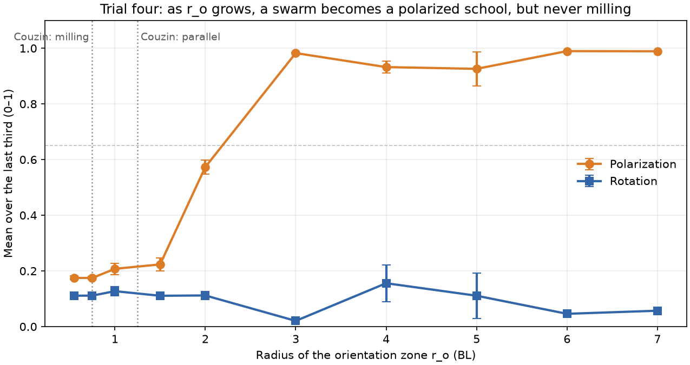
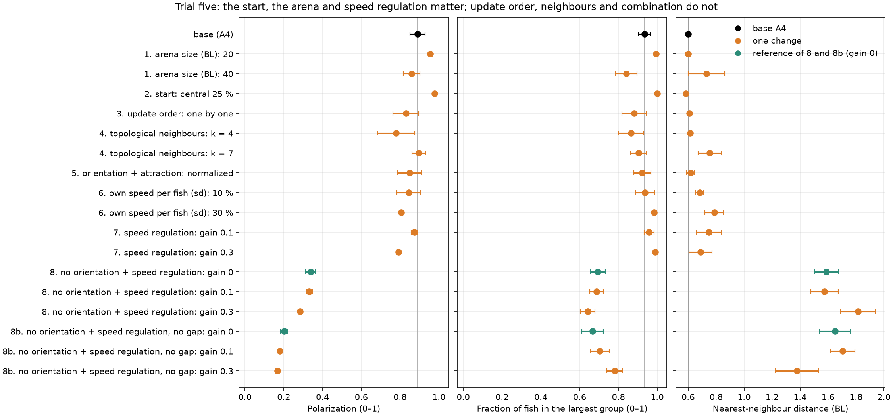
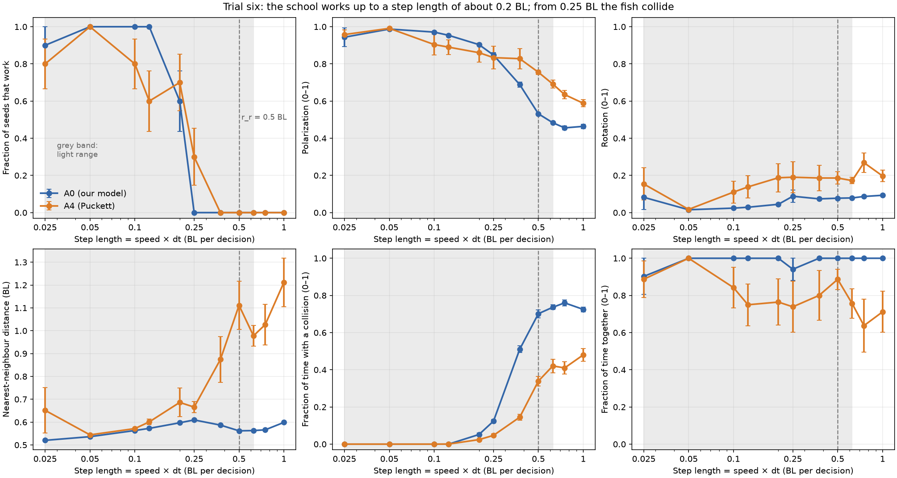
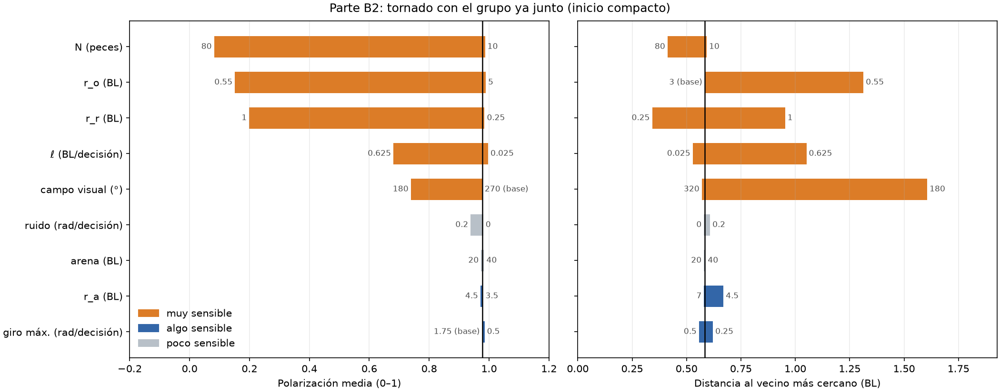
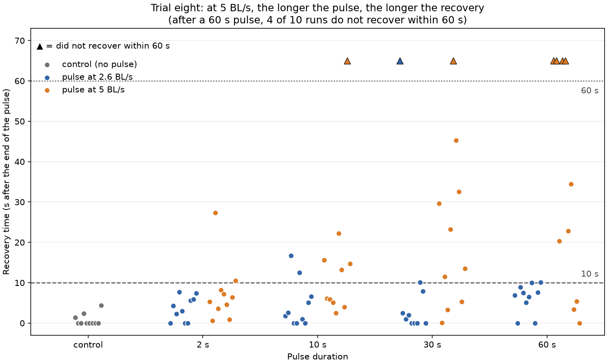

# Checks and trials before adding light

## How to use this folder

- **Environment:** Python 3.11. From the repository root run `python -m pip install -r checks/requirements.txt`, choose that environment as the notebook kernel, and use *Restart Kernel → Run All*.
- **Folder map:**
  - [`../shiner_model.py`](../shiner_model.py): the fish model. Every notebook imports this one file.
  - [`model_checks/`](model_checks/): checks 01 to 07 of the model. Run them in order; each takes seconds to minutes.
  - [`trial_one/`](trial_one/), [`trial_two/`](trial_two/), [`trial_three/`](trial_three/): the first three trials, kept as an archive with their saved outputs, data and figures.
  - [`study_code/`](study_code/): the code shared by trials four to eight: a study version of the model with Puckett's turn limit and noise per decision, the measurements, and 10 tests.
  - `trial_four_…/` to `trial_eight_…/`: one notebook each, with its `data/` and the one figure shown below.
  - [`check_support.py`](check_support.py): small helpers shared by the checks and trials one to three.
  - [`../Golden_Shiner_MAS_Complete.ipynb`](../Golden_Shiner_MAS_Complete.ipynb): the complete notebook, which runs the same model.
  - [`../past_repo/`](../past_repo/): earlier prototypes of the project (not used here).
- **Order:** read this file from top to bottom, and open a notebook for the details of a chapter.
- **Caching:** every trial saves its results in its `data/` folder and loads them instead of simulating again (in trials four to eight, set `study_tools.RERUN = True` to simulate again). Trials one to three also compare fingerprints (hashes) of their code, so their support modules (`diagnostics.py`, `relocation.py`, `study_support.py`, `temporal_support.py`) must not be edited. They are slow, so do not re-run them.
- **On the `develop` branch**, `shiner_model.py` contains Jacopo's light draft. Without light it gives exactly the same fish (test 1 of the study code), but the model-fingerprint checks of trial three (notebooks 01, 03 and 04) fail there on purpose. Run trials one to three on `main`.

## The project in one paragraph

Golden shiners are small fish that swim in schools and prefer dark water. A school can find dark areas even though each fish only senses the light where it is: fish swim faster in bright light and slower in the dark, and because they stay together, the whole group drifts towards the dark (Berdahl et al. 2013; Hein et al. 2015; Puckett et al. 2018). We model each fish as an agent that follows three local rules (Couzin et al. 2002). The goal is to add this light-dependent speed. Before adding light, we had to be sure that the social model works on its own. This folder documents that work.

## Key ideas in plain words

- **Agent-based model:** a simulation in which every fish is a small program (an *agent*) with simple rules. Group behaviour is not programmed; it emerges from the rules.
- **The three zones:** each fish looks at the fish around it in three rings. In the *repulsion* zone (too close) it swims away. In the *orientation* zone it copies their direction. In the *attraction* zone (farther away) it swims towards them. Repulsion has priority: if any fish is too close, the fish only avoids it (Couzin et al. 2002).
- **Body length (BL):** our unit of distance, the length of one fish, about 5 cm (Puckett et al. 2018, Table S1). Our zones end at 0.5, 3 and 5.5 BL.
- **Decision and dt:** every dt seconds, each fish looks around and picks a new direction. dt is the fish's reaction time. We use dt = 0.125 s, that is 8 decisions per second.
- **Step length:** how far a fish swims between two decisions, speed × dt. At 1 BL/s it is 0.125 BL.
- **Polarization:** a number from 0 to 1 that says how much the fish point the same way (1 = all the same direction).
- **Rotation (milling):** a number from 0 to 1 that says how much the fish swim in a circle around the group centre (1 = a perfect circle, called *milling*).
- **Together:** the fish form one connected group. Two fish are linked if they are at most 5.5 BL apart (the attraction radius); the group is together if every fish can be reached through links.
- **Collision:** two fish closer than 0.25 BL, half the repulsion radius. The model treats fish as points, so nothing physically stops two fish from overlapping.
- **Crowding:** when too many fish must share a small group, some always sit inside another fish's repulsion zone, keep escaping, and the group cannot line up (Chapter 7).

## Chapter 1: Building and checking the model

**What we asked.** Does the model do exactly what the rules say, and do the fish behave like a school?

**What we did.** We wrote one model file, [`shiner_model.py`](../shiner_model.py), that every notebook imports. It follows Couzin et al. (2002) and the supplement of Puckett et al. (2018): repulsion has priority, orientation and attraction are added as raw sums (Puckett et al. 2018, SI eq. 7), and all fish decide from the same old state before any fish moves. Then we checked it in seven notebooks:

| Check | What it tests |
|---|---|
| [01 Data collector](model_checks/01_data_collector.ipynb) | 21 small hand-made cases: the three rules, repulsion priority, fish on top of each other, walls and recording |
| [02 Recording](model_checks/02_recording_integrity.ipynb) | Every step is recorded once, and recording does not change the fish |
| [03 Metrics](model_checks/03_metric_validation.ipynb) | 62 cases with a known answer for polarization, rotation, spread and nearest neighbours |
| [04 Seeds](model_checks/04_schooling_across_seeds.ipynb) | 10 random starts with all rules, without orientation, without attraction and without any social rule (62.5 s each) |
| [05 Labels](model_checks/05_collective_state_summary.ipynb) | Names for the group state (polarized, milling, swarm) with the 0.35 / 0.65 thresholds of Tunstrøm et al. (2013) |
| [06 Plots](model_checks/06_diagnostic_plots.ipynb) | Time series, polarization against rotation, and positions |
| [07 Decision rate](model_checks/07_decision_rate.ipynb) | Exactly 8 decisions per fish per second, and what sub-steps change (Chapter 3) |

**What we found.** All checks passed. The social rules clearly matter: over the last 100 steps of check 04, the mean polarization was 0.87 with all rules and 0.22 without social rules, and the mean distance to the nearest neighbour was 0.65 BL against 2.53 BL. But not every start ended as one group: after 62.5 s, seed 0 was split into 10 + 10 fish and seed 2 into 19 + 1.

**What we decided, and why.** The rules work. The split seeds needed a closer look before adding light, so we started the trials.

## Chapter 2: Trials one to three, the problem that would not go away

**What we asked.** Why did some groups look broken? And why did the results change when we changed dt?

**What we did.** [Trial One](trial_one/) followed seeds 0 and 2 step by step and tested walls, smaller dt and three extra rules from Puckett et al. (2018): 270° vision, a turn limit and a small heading error. [Trial Two](trial_two/) ran 30 random starts for 180 s, defined when a group counts as assembled (one group for 5 s in a row), tested saving and reloading groups (*checkpoints*), and tested the heading error on 20 new seeds. [Trial Three](trial_three/) made dt smaller and smaller, first with instant turns (90 runs) and then with a turn limit of 14 rad/s (120 runs).

**What we found.**

| Trial | Main result |
|---|---|
| One | The groups were not breaking apart; they had not come together yet. No group split again after it was connected. Walls did not explain it: seeds 0 and 2 were split before touching a wall, also in a 40 × 40 BL arena. The extra rules did not help consistently. But at 5 BL/s the results depended strongly on dt: polarization 0.48, 0.79 and 0.94 for dt = 0.125, 0.0625 and 0.03125 s. |
| Two | All 30 groups came together within 180 s (median 28.5 s, slowest 86.75 s), and none broke apart afterwards. All 30 checkpoints reloaded exactly. The heading error did not help (20 of 20 new seeds assembled without it, 19 of 20 with it). Results still changed with dt: from dt = 0.03125 to 0.015625 s, the nearest-neighbour distance changed by almost 25 % at 1 BL/s. |
| Three | Smaller dt never made the results settle. Between the two smallest dt (0.015625 and 0.0078125 s), the group spread still changed by 27–52 % with instant turns. With the turn limit, only 1 of 9 comparisons passed. |

**What we decided, and why.** The broken groups were a waiting problem: give random starts enough time, or start from an assembled group. We did not add rules just to force the fish together. The dt problem was still open, and each trial ended with "not ready for light".

## Chapter 3: The key insight, dt is the reaction time

**What we asked.** Is the dt problem a numerical error that smaller steps should remove?

**What we did.** We looked at what dt does in our model and what it means in the papers. [Check 07](model_checks/07_decision_rate.ipynb) also tested *sub-steps*: fish decide every 0.125 s but move in 8 small steps of 1/64 s between decisions. Sub-steps were the idea of two commits in the complete notebook.

**What we found.**
- In our model, one dt sets two things at once: how far a fish moves in one step and how often it decides. A smaller dt makes a fish that reacts faster. That is a different fish, not a more accurate one, so the results can never "converge".
- The papers treat the time step as behaviour. Couzin et al. (2002) set it to the fish's reaction time, 0.1 s, and Puckett et al. (2018, Table S1) use 8 decisions per second, that is dt = 0.125 s.
- Sub-steps change nothing. Between two decisions a fish swims in a straight line, so 8 small steps end where one big step ends. At 1 BL/s the paths stayed the same: after 60 s the largest difference was less than a billionth of a body length. At 3 and 5 BL/s the runs drift apart, but no sooner than the normal model drifts from itself when every fish is moved by a trillionth of a body length: that is chaos, not a different model. Sub-steps were also 2.5 to 2.6 times slower.

**What we decided, and why.**
- dt = 0.125 s is fixed. It is a value from the literature, not a number to refine.
- No sub-steps, and the old idea of two separate clocks (one for decisions and one for movement) was dropped: with a fixed decision rate there is nothing left to converge, and sub-steps give the same paths.
- The complete notebook now uses the shared model too, so the project has one model.
- Trial Two's checkpoints were made with exactly these settings (dt = 0.125 s, 1 BL/s), so they can be used as starting groups.

## Chapter 4: Trial four, paper parameters

**When does a school "work"?** This definition was fixed in [`study_tools.py`](study_code/study_tools.py) before any of trials four to eight ran, and it is used by all of them. Every run lasts until each fish has swum 180 BL, and the last third of the run is measured. The school works if, in that last third:

1. **it is together:** the largest group holds at least 95 % of the fish during at least 90 % of the time;
2. **it does not collide:** some pair of fish is closer than 0.25 BL in at most 5 % of the time;
3. **it is ordered:** the mean polarization or the mean rotation is at least 0.65 (the state boundaries of Tunstrøm et al. 2013).

Each configuration runs with 10 seeds (random starts). A configuration works if it works in more than half of them.

**What we asked.** Do our fish behave as the papers say when we use their parameters (Couzin et al. 2002; Puckett et al. 2018)?

**What we did.** A ladder from our model (A0) to the Puckett model (A4), adding one thing at a time: 270° vision, a turn limit of 1.75 rad per decision, a heading error of 0.01 rad per decision, and a 28 × 28 BL arena (Puckett et al. 2018, Table S1). We also ran groups of 16, 32 and 64 fish at 0.2 to 5 BL/s, and Couzin's diagram: a larger and larger orientation zone, with Puckett's turn and with Couzin's slow turn of 0.07 rad per decision ([notebook](trial_four_paper_parameters/trial_four_paper_parameters.ipynb)).

**What we found.** A0, A1 and A2 work in 10 of 10 seeds, A3 in 9 and A4 in 6. The four failing A4 seeds are still assembling in the bigger arena (Chapter 5 shows that more time fixes them). With 64 fish the group is always a swarm (polarization 0.10 to 0.13). In Couzin's diagram the group is a swarm up to r_o = 1.5 BL and a polarized school from r_o = 3 BL, but it never mills with Puckett's turn. With Couzin's slow turn some seeds mill, but with collisions in 9 to 38 % of the time.

**What we decided, and why.** We use Puckett's parameters (A4) as the base, because they work for 20 fish at 1 BL/s. We start from an assembled group, because random starts lose time assembling. That this model does not mill is a limitation (see Limitations).

## Chapter 5: Trial five, parameters the papers did not take into account

**What we asked.** The model contains choices that the papers do not discuss. Does any of them change the behaviour?

**What we did.** From the base A4 we changed one thing at a time:
- the arena size (20 or 40 BL);
- a compact start, with the fish in a central square whose side is 25 % of the arena;
- updating the fish one by one instead of all at once;
- counting only the 4 or 7 nearest neighbours;
- adding orientation and attraction with equal weight;
- giving each fish its own speed (10 or 30 % spread);
- speed regulation inspired by Katz et al. (2011): a fish speeds up when its neighbours are far ahead and slows down when they are close ahead;
- speed regulation without orientation.

A change counts as relevant if it changes the verdict, or a 0–1 metric by more than 0.1, or a distance by more than 20 %, and the change is larger than 2 standard errors ([notebook](trial_five_parameters_not_in_papers/trial_five_parameters_not_in_papers.ipynb)).

**What we found.**
- **Relevant:**
  - a 20 BL arena (distance to the group centre −59 %);
  - the compact start (−62 %);
  - a 30 % speed spread (nearest-neighbour distance +31 %);
  - speed regulation with gain 0.3 (−58 %, and 10 of 10 seeds work).
- **Not relevant:** update order, nearest neighbours only, and equal weights.
- **Without orientation:** there is never a school, even with speed regulation (0 of 10 seeds).
- **More time:** with three times more swimming (540 BL), the base works in 10 of 10 seeds.

**What we decided, and why.** We keep the simplest choices, which are also Puckett's: all fish update at once, every neighbour inside the zones counts, orientation and attraction are added as raw sums (Puckett et al. 2018, SI eq. 7), all fish have the same speed, and there is no speed regulation. The start and the arena matter only through the time the group needs to assemble.

## Chapter 6: Trial six, dt and speed

**What we asked.** What changes when we change dt and the speed, and what stays the same?

**What we did.** We checked exactly whether runs with the same step length (speed × dt) give the same trajectories. Then we swept the step length from 0.025 to 1 BL for A0 and A4, and placed Trial One on the same curve ([notebook](trial_six_dt_and_speed/trial_six_dt_and_speed.ipynb)).

**What we found.**
- **Only the step length matters** when the turn limit and the noise are given per decision. For example, (1 BL/s, dt 0.25 s) and (2 BL/s, dt 0.125 s) give exactly the same trajectories: difference 0. Doubling every distance gives the same school, twice as big. A turn limit or noise given per second breaks this: the same pairs end 12 to 25 BL apart.
- **Collisions follow a simple rule.** Two fish swimming towards each other come 2 × step length closer in one decision, so the closest distance is about 0.5 − 2 × step length. It reaches the collision threshold (0.25 BL) at a step length of 0.125 BL, our model at 1 BL/s.
- **A0 works** in 9 or 10 of 10 seeds up to a step length of 0.125 BL, in 6 at 0.2, and in none from 0.25. The time with a collision is 12 % at 0.25, 51 % at 0.375 and 70 % at 0.5.
- **A4 keeps more order** (polarization 0.69 at 0.625 BL) but still collides in 42 % of the time.
- **Trial One falls on the same curve:** polarization 0.48, 0.79 and 0.94. Its dt problem was this step-length effect.

**What we decided, and why.** Speed and dt are not two parameters: only their product matters, so turn limit and noise are always given per decision. Light will change the speed from 0.2 to 5 BL/s (Puckett et al. 2018), that is step lengths from 0.025 to 0.625 BL. Only up to about 1.6 BL/s (step length 0.2 BL) does the school stay without collisions. That leaves three options for the fast parts:
- **A:** keep Puckett as it is;
- **B:** cap the speed at 1.6 BL/s;
- **C:** let fast fish decide more often.

Chapter 8 tests how bad option A is.

## Chapter 7: Trial seven, the minimum model and the sensitive parameters

**What we asked.** Which rules are essential? Which parameters change the behaviour a lot? What is the simplest model that still works?

**What we did.** We switched rules off, and changed one parameter at a time, first with random starts and then with the group already together (compact start). We tested the minimal model on 10 new seeds (10–19) ([notebook](trial_seven_minimum_parameters/trial_seven_minimum_parameters.ipynb)).

**What we found.**
- **Rules:**
  - without repulsion the fish pile up (a collision 100 % of the time);
  - without orientation there is never order (0 of 10 seeds);
  - with repulsion and orientation alone, A0 works in 10 of 10 seeds, so attraction is not needed to keep an assembled group together.
- **Random starts:** every parameter comes out "very sensitive". The reason is that the base is on the edge (6 of 10 seeds work, the other 4 are still assembling), so any change flips the verdict. We report this as it is.
- **Group already together:**

  | Class | Parameters |
  |---|---|
  | very sensitive | r_r, r_o, N, the field of view (only at 180°) and the step length (from 0.25 BL) |
  | somewhat sensitive | r_a and the turn limit |
  | not very sensitive | noise (0 to 0.2 rad) and arena size (20 to 40 BL) |

- **The minimal model** works in 10 of 10 new seeds: three rules, 360° vision, instant turns, no noise, a 28 BL arena and a compact start. With a random start it works in 6.

**Crowding explains why r_r, r_o and N are sensitive in the same way.** Attraction pulls the group together until it is about r_o wide. A circle that wide holds about 0.9 × (r_o / r_r)² fish without anyone inside another fish's repulsion zone: about 33 fish for r_r = 0.5 and r_o = 3 BL. *Crowding* is N divided by that number. Above about 1, some fish are always escaping, and because repulsion has priority they stop aligning:

| Group already together | Crowding | Polarization |
|---|---:|---:|
| base (20 fish, r_r 0.5, r_o 3 BL) | 0.61 | 0.98 |
| 40 fish | 1.23 | 0.61 |
| r_r = 0.75 BL | 1.38 | 0.69 |
| r_o = 2 BL | 1.38 | 0.59 |
| r_r = 1 BL | 2.45 | 0.20 |
| 80 fish | 2.45 | 0.08 |

**What we decided, and why.**
- Keep all three rules. Attraction is needed for the group to assemble, and for the light mechanism, in which fast fish follow slow ones (Berdahl et al. 2013).
- Keep Puckett's radii and 20 fish, well below the crowding limit.
- Leave the parameters that are not very sensitive at the paper values.

## Chapter 8: Trial eight, a speed pulse (is option C needed?)

**What we asked.** When fish swim fast for a while, is the damage temporary (the group recovers when it slows down) or permanent?

**What we did.** Each run swims 60 s at 1 BL/s, then a pulse at 2.6 or 5 BL/s for 2, 10, 30 or 60 s, then 60 s at 1 BL/s again. There is also a control without a pulse; each combination ran with 10 seeds.

The group **recovered** once there were 5 s in a row with at least 19 of the 20 fish together, polarization of at least 0.9 and no collision. The rule was fixed before running:
- "A is enough" if, for every combination, at least 9 of 10 seeds recover within 10 s;
- "A has a real problem" if, in some combination, 2 or more seeds do not recover within 60 s;
- "grey zone" otherwise.

In a second test, the speed went up from 0.2 to 5 BL/s and back down in one long run ([notebook](trial_eight_speed_pulse/trial_eight_speed_pulse.ipynb)).

**What we found.**
- The control passes: 10 of 10 seeds recover within 10 s.
- After a pulse at 2.6 BL/s, 8 to 10 of 10 seeds recover within 10 s.
- At 5 BL/s it gets worse with the length of the pulse: 8, 5, 3 and 3 of 10 seeds recover within 10 s.
- **After 60 s at 5 BL/s, 4 of 10 seeds do not recover within 60 s.**
- Those groups are not broken: 1 to 3 fish are missing. With a 300 s recovery all of them come back (after 70 to 167 s).
- During a pulse at 5 BL/s some pair collides in 25 to 38 % of the time, the closest fish come to about 0.02 BL, and polarization falls to about 0.7.
- There is no memory: going up and going down, the group behaves the same.

**What we decided, and why.** By the rule fixed before running, **"A has a real problem"**, so C (or B) must be ready together with light. The reason is not that the group breaks for good: it does not, and there is no memory. The reason is that the fast phases produce collisions and loose fish, which are artefacts exactly where the light mechanism acts.

## The model we take to the light phase

| Parameter | Value | Source | Why |
|---|---|---|---|
| Decision interval dt | 0.125 s (8 per second) | Puckett et al. 2018, Table S1; Couzin et al. 2002 (0.1 s) | It is the reaction time, so it is fixed, not refined (Chapters 3 and 6) |
| Zones r_r, r_o, r_a | 0.5, 3 and 5.5 BL | Puckett et al. 2018, Table S1 | r_r and r_o are very sensitive; these values leave room before crowding (Chapter 7) |
| Number of fish | 20 | our choice | Crowding 0.61; about 33 fit; 64 fish are always a swarm (Chapters 4 and 7) |
| Field of view | 270° | Puckett et al. 2018, Table S1 | Matters only at 180° (Chapter 7) |
| Turn limit, heading error | 1.75 and 0.01 rad per decision | Puckett et al. 2018, Table S1 | Per decision, so only the step length matters; small effects (Chapters 6 and 7) |
| Arena | 28 × 28 BL, reflecting walls | Puckett et al. 2018, Table S1 (140 cm) | Not sensitive once the group is together (Chapter 7) |
| Speed | 1 BL/s without light; 0.2 to 5 BL/s with light | Puckett et al. 2018 (1 to 25 cm/s) | Needs the A/B/C switch below (Chapter 8) |
| Rules | all three, repulsion first, all fish at once, raw sums | Couzin et al. 2002; Puckett et al. 2018, SI eq. 7 | The alternatives change nothing (Chapter 5) |
| Start | an assembled group | trials two, seven and eight | Random starts are still assembling (Chapters 2, 4 and 5) |

## Limitations

- Fish are points. At large step lengths they pass through each other. Puckett et al. (2018) also report neighbours closer than 0.5 BL in their model for 128 or more fish, and blame over-crowding and the low time resolution.
- In the model, faster fish are less ordered; real fish are more ordered when faster (Tunstrøm et al. 2013).
- With Puckett's turn the model never mills, while real golden shiners do (Tunstrøm et al. 2013).
- Neighbours are about 0.6 BL apart in the model, while in real shiners they are usually 1.5 to 2 BL apart (Katz et al. 2011).
- Above about 30 fish the model becomes a swarm (crowding); Puckett's experiments used 16 to 128 fish.
- Every result uses 10 seeds, and the thresholds (95 %, 0.65, 0.25 BL, …) are project choices.
- On `develop`, `shiner_model.py` contains Jacopo's light draft, which is not validated yet; the model-fingerprint checks of trial three (notebooks 01, 03 and 04) fail there.

## Final Decision for Next Steps with Light Implementation

1. **Where the light goes.** In its own file (for example `light_model.py`), with classes that inherit from [`study_code`](study_code/study_model.py), without changing `shiner_model.py`. The study code already has Puckett's turn limit and noise per decision.
2. **A switch with three options for the fast parts of the light field:**
   - **A:** the Puckett model as it is (8 decisions per second, speeds 0.2 to 5 BL/s).
   - **B:** the same, with a maximum speed of 1.6 BL/s (step length 0.2 BL). This is one line of code.
   - **C:** each fish decides every 0.125 s, or earlier once it has swum 0.125 BL since its last decision. Write it from scratch with a simple "distance since the last decision" counter. Do not reuse the old sub-step cell of the complete notebook, which decided at a fixed rate.
3. **The first thing to measure with light, using A:** the fraction of time the fish swim faster than 1.6 BL/s.
4. **The rule to choose the main model, fixed before running the light experiments:** if, with A, the fish spend more than 10 % of their time above 1.6 BL/s, C is the main model. Otherwise A (Puckett) is the main model, and B and C are robustness checks. The 10 % threshold is a proposal: the group must confirm it before running, and it must not be changed after seeing the results.
5. **Why C is not the main model by default.** With C, light changes two things at once: the speed, and how often the fish decides (up to 40 times per second instead of 8). Puckett does not do this, so if the light result changed, we could not tell which of the two caused it.
6. **Checks that every light experiment needs:**
   - a speed range wide enough to see an effect (Puckett: 0.2 to 5 BL/s);
   - a dark region that is not only next to a wall (for example also in the middle), so walls cannot explain the result;
   - a control with solitary fish (no social rules), as Berdahl et al. (2013) did, to show that the effect is collective;
   - light measurements, such as the mean light the fish experience and the time the group needs to reach the dark region.
7. **Start from an assembled group** (as in trials seven and eight), because with random starts many groups are still assembling.

## References

- Berdahl, A., Torney, C. J., Ioannou, C. C., Faria, J. J., & Couzin, I. D. (2013). Emergent sensing of complex environments by mobile animal groups. *Science, 339*(6119), 574–576. https://doi.org/10.1126/science.1225883
- Couzin, I. D., Krause, J., James, R., Ruxton, G. D., & Franks, N. R. (2002). Collective memory and spatial sorting in animal groups. *Journal of Theoretical Biology, 218*(1), 1–11. https://doi.org/10.1006/jtbi.2002.3065
- Hein, A. M., Rosenthal, S. B., Hagstrom, G. I., Berdahl, A., Torney, C. J., & Couzin, I. D. (2015). The evolution of distributed sensing and collective computation in animal populations. *eLife, 4*, e10955. https://doi.org/10.7554/eLife.10955
- Katz, Y., Tunstrøm, K., Ioannou, C. C., Huepe, C., & Couzin, I. D. (2011). Inferring the structure and dynamics of interactions in schooling fish. *PNAS, 108*(46), 18720–18725. https://doi.org/10.1073/pnas.1107583108
- Puckett, J. G., Pokhrel, A. R., & Giannini, J. A. (2018). Collective gradient sensing in fish schools. *Scientific Reports, 8*, 7587. https://doi.org/10.1038/s41598-018-26037-9 ([supplement](https://static-content.springer.com/esm/art%3A10.1038%2Fs41598-018-26037-9/MediaObjects/41598_2018_26037_MOESM1_ESM.pdf))
- Tunstrøm, K., Katz, Y., Ioannou, C. C., Huepe, C., Lutz, M. J., & Couzin, I. D. (2013). Collective states, multistability and transitional behavior in schooling fish. *PLoS Computational Biology, 9*(2), e1002915. https://doi.org/10.1371/journal.pcbi.1002915
