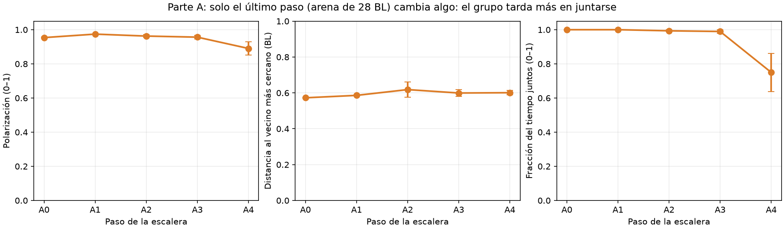
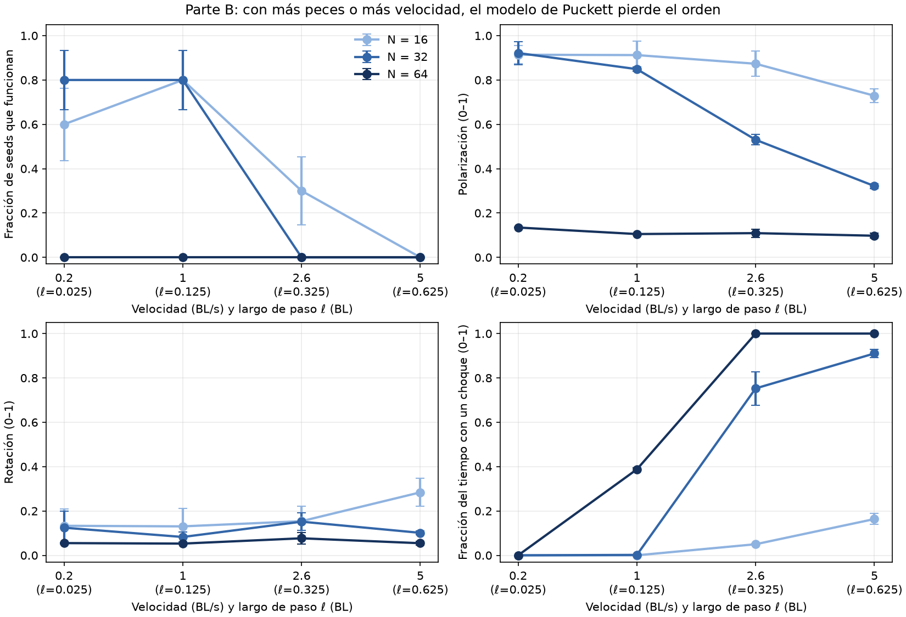
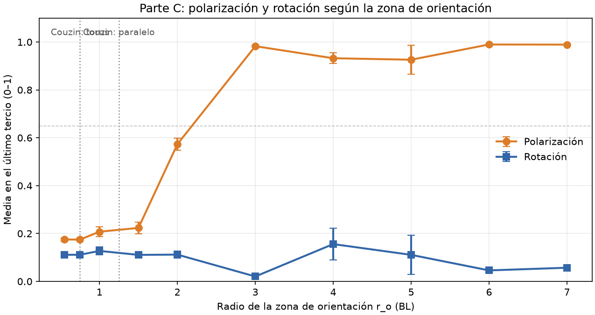
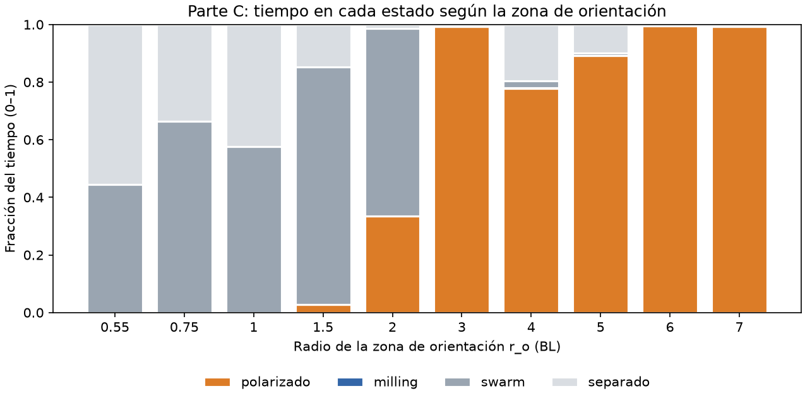
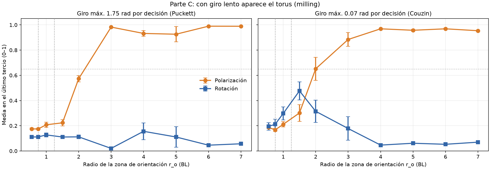
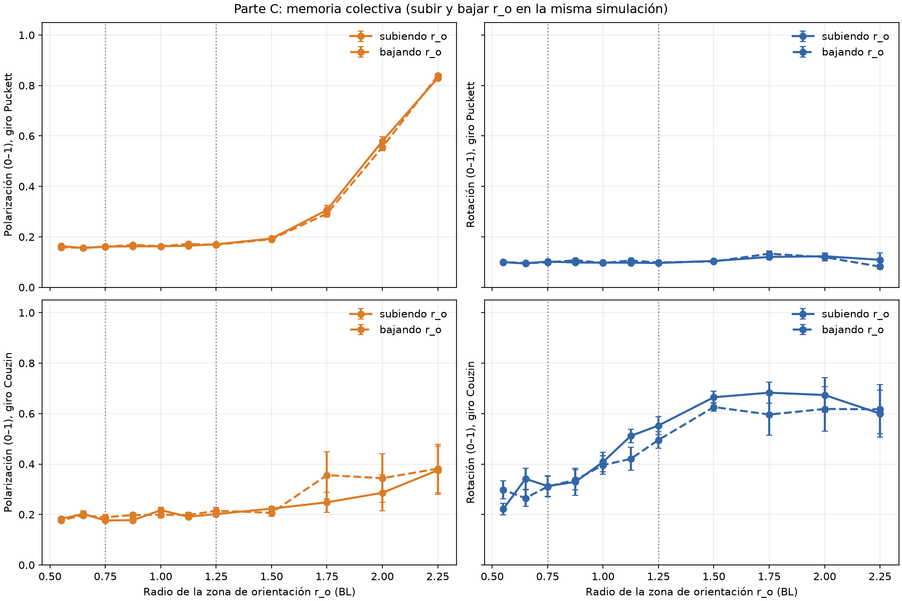

# Estudio 1 — Los parámetros de los papers

## Pregunta

Si usamos los mismos parámetros que Couzin (2002) y Puckett et al. (2018), ¿nuestros peces se comportan como dicen los papers?

## ¿Por qué?

Hoy nuestro modelo es una versión simplificada:
- los peces ven 360°;
- giran de golpe;
- no tienen ruido.

En los papers, en cambio, los peces no ven detrás de ellos, giran como máximo unos 100° por decisión y se equivocan un poquito al elegir su dirección. Queremos saber si eso cambia algo.

---

## Parte A — Escalera: de nuestro modelo al de Puckett

Agregamos **una cosa a la vez** para ver cuál de los cambios mueve los resultados.
En todos los pasos: N = 20, velocidad 1 BL/s, dt 0.125 s y 10 seeds.

| Paso | Configuración |
|---|---|
| A0 | Nuestro modelo actual: 360°, giro de golpe, sin ruido, arena 20 × 20 BL |
| A1 | A0 + campo visual de 270° |
| A2 | A1 + giro máximo de 1.75 rad por decisión |
| A3 | A2 + ruido de 0.01 rad por decisión |
| A4 | A3 + arena de 28 × 28 BL, es decir, **el modelo de Puckett/Berdahl** |

## Parte B — El modelo de Puckett con distintos grupos y velocidades

Usamos la configuración A4 con:
- N = 16, 32 y 64 peces (los tamaños de los experimentos de Puckett);
- velocidad = 0.2, 1, 2.6 y 5 BL/s (el rango que va a tener la luz).

Son 12 combinaciones con 10 seeds cada una. Si N = 64 a 0.2 BL/s tarda demasiado, se pueden usar 5 seeds.

## Parte C — El diagrama de Couzin

Couzin (2002) encontró que, al agrandar la zona de orientación, el grupo pasa por estados distintos:

| Zona de orientación | Estado del grupo |
|---|---|
| casi nada | **swarm**: juntos pero desordenados |
| pequeña | **torus**: nadan en círculo alrededor de un centro vacío |
| mediana | **grupo paralelo dinámico**: todos hacia el mismo lado, pero cambiando |
| grande | **grupo muy paralelo**: todos hacia el mismo lado, en línea recta |

Lo que probamos:
- Configuración A4 con r_r = 0.5 BL y r_a = 7 BL fijos.
- r_o = 0.55, 0.75, 1, 1.5, 2, 3, 4, 5, 6 y 7 BL.
- Gráfico de polarización y rotación en función de r_o.

Para comparar con la figura de Couzin: en Couzin, r_r = 1 "unidad", que en nuestro modelo son 0.5 BL. Así que su transición a torus (r_o ≈ 1.5 unidades) corresponde a r_o ≈ 0.75 BL, y su paso a grupo polarizado (r_o > 2.5 unidades) corresponde a r_o > 1.25 BL.

Opcional, la **memoria colectiva** de Couzin: en una sola simulación larga, subir r_o poco a poco y después bajarlo. Couzin encontró que el grupo "se acuerda" de dónde venía, es decir, que no vuelve por el mismo camino.

**Ojo:** el modelo de Couzin es 3D y el nuestro es 2D, así que los resultados pueden ser algo distintos.

---

## Qué medimos

Todo lo que dice el README general: si funciona o no, polarización, rotación, distancia al vecino más cercano, fracción del grupo más grande, choques y en qué estado está el grupo.

## Qué esperamos (según los papers)

- **Parte A:** el campo visual y el giro máximo podrían hacer aparecer el *milling* (torus). Un ruido tan pequeño como 0.01 rad debería cambiar poco.
- **Parte B:** en golden shiners reales, más velocidad lleva a estados más ordenados, milling o polarizado (Tunstrøm et al. 2013). En nuestro modelo, la velocidad influye a través de ℓ (ver el estudio 3). A 5 BL/s, ℓ = 0.625 BL, que es más grande que la zona de repulsión (0.5 BL), así que esperamos algunos choques. Puckett también vio distancias menores a 0.5 BL en grupos grandes.
- **Parte C:** swarm → torus → paralelo, como en Couzin.

---

## Resultados

Cuaderno: [`study_01.ipynb`](study_01.ipynb). Datos: `data/results.csv` (370 simulaciones) y los dos experimentos de memoria (`data/part_c_memory*.csv`).

### Parte A — La escalera

| Paso | Qué agregamos | Funciona | Polarización | Vecino más cercano (BL) | Tiempo juntos | Choques |
|---|---|---|---|---|---|---|
| A0 | nuestro modelo | 10/10 | 0.95 | 0.57 | 100 % | 0 % |
| A1 | + campo visual de 270° | 10/10 | 0.97 | 0.59 | 100 % | 0 % |
| A2 | + giro máximo de 1.75 rad por decisión | 10/10 | 0.96 | 0.62 | 99 % | 0 % |
| A3 | + ruido de 0.01 rad por decisión | 9/10 | 0.96 | 0.60 | 99 % | 0 % |
| A4 | + arena de 28 × 28 BL (= Puckett) | **6/10** | 0.89 | 0.60 | **75 %** | 0 % |

- El campo visual, el giro máximo y el ruido **casi no cambian nada**.
- **El único paso que importa es la arena de 28 BL:** las 4 seeds que fallan terminan con el grupo separado. No es que el cardumen se rompa: en una arena más grande los peces tardan más en encontrarse, y en 180 BL de nado algunos grupos todavía no se juntaron. Con el triple de tiempo, o empezando juntos, funcionan las 10 (estudios 2 y 4).
- No apareció *milling* en ningún paso (rotación ≤ 0.14).

### Parte B — Puckett con distintos grupos y velocidades

| N | 0.2 BL/s (ℓ = 0.025) | 1 BL/s (ℓ = 0.125) | 2.6 BL/s (ℓ = 0.325) | 5 BL/s (ℓ = 0.625) |
|---|---|---|---|---|
| 16 | 6/10 · pol. 0.91 · choques 0 % | 8/10 · 0.91 · 0 % | 3/10 · 0.87 · 5 % | 0/10 · 0.73 · 16 % |
| 32 | 8/10 · 0.92 · 0 % | 8/10 · 0.85 · 0 % | 0/10 · 0.53 · 75 % | 0/10 · 0.32 · 91 % |
| 64 | 0/10 · **0.13** · 0 % | 0/10 · **0.10** · 39 % | 0/10 · 0.11 · 100 % | 0/10 · 0.10 · 100 % |

Cada casilla: seeds que funcionan · polarización media · fracción del tiempo con un choque.

- **Más velocidad = menos orden y más choques.** Es lo contrario de los golden shiners reales, que se ordenan más cuando nadan más rápido (Tunstrøm et al. 2013). En el modelo la velocidad actúa a través de ℓ: con ℓ grande los peces se saltan la zona de repulsión entre dos decisiones (estudio 3).
- **Con 64 peces, el grupo siempre es un *swarm*** (polarización 0.10–0.13), incluso a 0.2 BL/s y sin choques. La razón es el **apiñamiento** (estudio 4, parte D): la atracción junta al grupo hasta que su diámetro es más o menos r_o = 3 BL, y ahí caben unos 33 peces sin invadir la zona de repulsión de otro. Con 64 siempre hay alguien dentro de esa zona; como la repulsión tiene prioridad, nadie se alinea. Con 32 peces estamos justo en el límite.
- Puckett et al. (2018) también vieron que la distancia al vecino baja con N, y con 128 peces o más queda por debajo de 0.5 BL (p. 6).

### Parte C — El diagrama de Couzin

**Con el giro de Puckett (1.75 rad por decisión):**

| r_o (BL) | 0.55 | 0.75 | 1 | 1.5 | 2 | 3 | 4 | 5 | 6 | 7 |
|---|---|---|---|---|---|---|---|---|---|---|
| Polarización | 0.18 | 0.18 | 0.21 | 0.22 | 0.57 | 0.98 | 0.93 | 0.93 | 0.99 | 0.99 |
| Rotación | 0.11 | 0.11 | 0.13 | 0.11 | 0.11 | 0.02 | 0.16 | 0.11 | 0.05 | 0.06 |
| Estado | swarm o separado | swarm o separado | swarm o separado | swarm | swarm / polarizado | polarizado | polarizado | polarizado | polarizado | polarizado |

- Aparecen el **swarm** y el **grupo polarizado**, pero **no el torus** (*milling*).
- El paso a polarizado ocurre entre r_o = 2 y 3 BL, no en 1.25 BL como en Couzin. Lo explica el apiñamiento: con 20 peces en 2D hace falta r_o ≥ 0.5 × √(20 / 0.9) ≈ 2.4 BL. Couzin trabaja en 3D, donde caben muchos más peces en la zona de orientación.

**Extra: con el giro lento de Couzin (0.07 rad = 4° por decisión).** Couzin (2002, Fig. 3) usa un giro máximo de 40°/s con pasos de 0.1 s; Puckett permite 25 veces más por decisión. Cambiando **solo** el giro:

| r_o (BL) | 0.55 | 0.75 | 1 | 1.5 | 2 | 3 | 4 a 7 |
|---|---|---|---|---|---|---|---|
| Polarización | 0.19 | 0.17 | 0.21 | 0.30 | 0.65 | 0.88 | 0.95–0.97 |
| Rotación | 0.20 | 0.21 | 0.30 | **0.48** | 0.32 | 0.18 | 0.05–0.07 |
| Seeds que terminan en *milling* | 0 | 0 | 0 | **3** | **2** | 0 | 0 |
| Choques | 38 % | 34 % | 34 % | 38 % | 27 % | 15 % | 9–12 % |

- **Con giro lento sí aparece el torus**, entre el swarm y el grupo polarizado, como en Couzin: swarm → torus → polarizado.
- El precio son **muchos choques**: un pez que gira solo 4° por decisión no alcanza a esquivar a tiempo.

**Memoria colectiva** (una sola simulación larga: subir r_o de 0.55 a 2.25 BL y volver a bajarlo, 2000 decisiones por valor, 10 seeds):

- **Giro de Puckett:** las curvas de subida y de bajada son **iguales**. No hay memoria, porque no hay dos estados posibles entre los que "recordar".
- **Giro lento de Couzin:** desde r_o ≈ 1.25 BL el grupo entra en un **torus estable** (rotación 0.67 con r_o = 1.5–2 BL) y sigue en torus hasta 2.25 BL, al subir y al bajar. No vemos la memoria de Couzin (en él, al bajar desde el grupo polarizado ya no vuelve el torus), porque nuestra subida nunca llegó a polarizarse antes de 2.25 BL. **Sí hay dependencia de la historia:** con r_o = 2 BL, un grupo que viene del torus se queda en torus (rotación 0.67), mientras que con inicio al azar la mitad de las seeds terminan polarizadas. Esto se parece a la biestabilidad entre *milling* y polarizado que Tunstrøm et al. (2013) vieron en golden shiners reales.

## Conclusión

- **¿El modelo de Puckett (A4) funciona en nuestro proyecto?** **Sí, con 20 peces a 1 BL/s**, siempre que el grupo tenga tiempo para juntarse (10/10 con el triple de tiempo) o empiece junto (10/10). Con inicio al azar y 180 BL, solo 6/10. **No funciona** con 64 peces (siempre *swarm*, por apiñamiento) ni con velocidades altas (desde 2.6 BL/s hay choques y menos orden).
- **¿Cuál de los pasos de la escalera cambió más los resultados?** **La arena de 28 BL** (de 10/10 a 6/10), y solo porque los peces tardan más en encontrarse. El campo visual de 270°, el giro de 1.75 rad y el ruido de 0.01 rad casi no cambian nada.
- **¿Reproducimos los estados de Couzin?** **En parte.** Con los parámetros de Puckett aparecen el swarm y el grupo polarizado, pero **no el torus**: el giro de Puckett es demasiado rápido. Con el giro lento de Couzin aparece el torus, con muchos choques. El paso a polarizado necesita un r_o más grande que en Couzin, por el apiñamiento en 2D.

**Lo más interesante:** los golden shiners reales hacen *milling* a menudo, sobre todo en grupos grandes (Tunstrøm et al. 2013), pero con el giro de Puckett nuestro modelo **nunca** lo hace. Para el experimento de luz no es un problema (el mecanismo de Puckett no necesita *milling*), pero es una diferencia con los peces reales que hay que mencionar.
