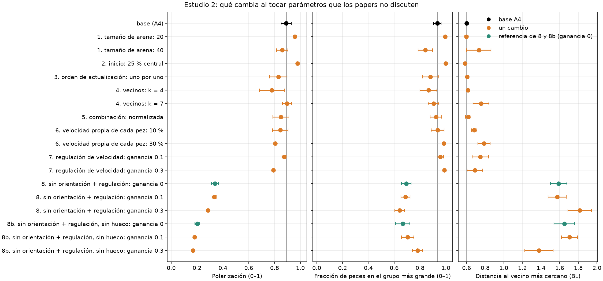

# Estudio 2 — Parámetros que nadie tuvo en cuenta

## Pregunta

En el modelo hay decisiones que los papers no discuten o que tomaron sin probarlas. ¿Alguna de ellas cambia mucho el comportamiento?

## Cómo lo hacemos

- **Base:** la configuración A4 del estudio 1 (el modelo de Puckett), con N = 20 y velocidad 1 BL/s.
- Cambiamos **una sola cosa a la vez** y corremos 10 seeds para cada valor.

| # | Parámetro | Qué es, en simple | Valores | Por qué probarlo |
|---|---|---|---|---|
| 1 | Tamaño de arena | el mismo número de peces en más o menos espacio (densidad y cuánto chocan con las paredes) | 20, 28 y 40 BL | Trial One sospechó de las paredes |
| 2 | Inicio | dónde empiezan los peces | en todo el tanque, o solo en el 25 % central | en Trial Two, a algunos grupos les tomó hasta 87 s juntarse |
| 3 | Orden de actualización | todos deciden a la vez, o uno por uno en orden aleatorio | a la vez, uno por uno | Couzin hace que todos decidan a la vez; en la vida real no hay "turnos" |
| 4 | Qué vecinos cuentan | todos los que están cerca, o solo los k más cercanos | por distancia, k = 4, k = 7 | en la literatura se discute si los animales miran a los vecinos a cierta distancia o a un número fijo de vecinos |
| 5 | Cómo se combinan orientación y atracción | suma directa, o cada una normalizada antes de sumar | suma directa, normalizada | era la diferencia entre el notebook viejo y `shiner_model.py` |
| 6 | Velocidad distinta para cada pez | cada pez tiene su propia velocidad fija | variación de 0 %, 10 % y 30 % | según Couzin (2002), las diferencias de velocidad ordenan el grupo (los rápidos van adelante) |
| 7 | Regulación de velocidad | el pez acelera o frena según dónde están sus vecinos | ganancia 0, 0.1 y 0.3 | según Katz (2011), en golden shiners regular la velocidad es **la interacción más importante** |
| 8 | Sin orientación, pero con regulación de velocidad | solo repulsión y atracción, más la regulación de velocidad | ganancia 0.1 y 0.3 | según Katz, la alineación sale sola de la atracción y la repulsión |

(Las paredes "periódicas", en las que el pez sale por un lado y entra por el otro, quedan fuera porque complican mucho las métricas. El efecto de las paredes lo vemos con el tamaño de arena.)

### La regla de regulación de velocidad

Es una regla simple **inspirada** en Katz (2011), **no ajustada** a sus datos:

- si un vecino está **cerca** (en la zona de repulsión) y **adelante** → el pez frena;
- si un vecino está **cerca** y **atrás** → el pez acelera;
- si un vecino está **lejos** (en la zona de orientación o de atracción) y **adelante** → el pez acelera;
- si un vecino está **lejos** y **atrás** → el pez frena.

Cómo se calcula:
- Para cada vecino se mide su distancia "adelante/atrás": positiva si está adelante y negativa si está atrás, en BL.
- Si ese vecino está en la zona de repulsión, se le cambia el signo.
- La señal es el promedio de esos números entre todos los vecinos.
- velocidad = velocidad base × (1 + ganancia × señal), limitada a entre 0.5 y 1.5 veces la velocidad base.

## ¿Cuándo decimos que un parámetro "es relevante"?

Un parámetro es relevante si, al cambiarlo, pasa al menos una de estas tres cosas:
- cambia el resultado de "funciona / no funciona";
- la polarización, la rotación o la fracción del grupo más grande cambian más de 0.1;
- la distancia al vecino o al centro cambia más de un 20 %.

**Además**, el cambio tiene que ser mayor que el doble del error estándar entre seeds. Si no pasa nada de esto, el parámetro "no es relevante" y lo dejamos en su valor más simple.

---

## Resultados

Cuaderno: [`study_02.ipynb`](study_02.ipynb). Datos: `data/results.csv` (180 simulaciones) y `data/extra_longer_runs.csv`.

**Antes de leer la tabla:** la base (Puckett, A4) funciona solo en **6 de 10** seeds. Las 4 que fallan terminan con el grupo **separado**, porque en 180 BL de nado todavía no se juntó en la arena de 28 BL. No es que el cardumen se rompa: con el triple de tiempo (540 BL) funcionan **las 10** (ver "Extra" abajo). Por eso las seeds se parecen poco entre sí, y algunos cambios que parecen grandes no pasan el filtro de "más que 2 errores estándar".

### Cada valor comparado con la base

| # | Parámetro | Valor | Funciona | Polarización | Grupo más grande | Vecino más cercano (BL) | Distancia al centro (BL) |
|---|---|---|---|---|---|---|---|
| — | base (A4) | — | 6/10 | 0.89 | 0.93 | 0.60 | 3.0 |
| 1 | Tamaño de arena | 20 BL | **9/10** | 0.96 | 0.99 | 0.60 | **1.2** |
| 1 | Tamaño de arena | 40 BL | 4/10 | 0.86 | 0.84 | 0.73 | 5.3 |
| 2 | Inicio | 25 % central | **10/10** | 0.98 | 1.00 | 0.58 | **1.1** |
| 3 | Orden de actualización | uno por uno | 6/10 | 0.83 | 0.88 | 0.61 | 3.6 |
| 4 | Vecinos | k = 4 | 6/10 | 0.78 | 0.87 | 0.62 | 4.5 |
| 4 | Vecinos | k = 7 | 6/10 | 0.90 | 0.91 | 0.76 | 3.3 |
| 5 | Combinación | normalizada | 7/10 | 0.85 | 0.92 | 0.62 | 3.3 |
| 6 | Velocidad propia de cada pez | 10 % | 8/10 | 0.84 | 0.94 | 0.68 | 2.4 |
| 6 | Velocidad propia de cada pez | 30 % | 9/10 | 0.81 | 0.99 | **0.79** | 1.7 |
| 7 | Regulación de velocidad | ganancia 0.1 | 8/10 | 0.87 | 0.96 | 0.75 | 2.2 |
| 7 | Regulación de velocidad | ganancia 0.3 | **10/10** | 0.79 | 0.99 | 0.69 | **1.3** |
| 8 | Sin orientación + regulación | ganancia 0 | 0/10 | 0.34 | 0.69 | 1.59 | 7.4 |
| 8 | Sin orientación + regulación | ganancia 0.1 | 0/10 | 0.33 | 0.69 | 1.57 | 7.4 |
| 8 | Sin orientación + regulación | ganancia 0.3 | 0/10 | 0.29 | 0.64 | 1.82 | 7.9 |
| 8b | Igual, sin hueco (extra) | ganancia 0 | 0/10 | 0.20 | 0.67 | 1.65 | 6.8 |
| 8b | Igual, sin hueco (extra) | ganancia 0.1 | 0/10 | 0.18 | 0.70 | 1.71 | 6.4 |
| 8b | Igual, sin hueco (extra) | ganancia 0.3 | 0/10 | 0.17 | 0.78 | 1.38 | 5.4 |

Medias de 10 seeds. En negrita, lo que pasa el criterio de "relevante".

### ¿Es relevante? (criterio del README, fijado antes de correr)

Los parámetros 1–7 se comparan con la base. El 8 y el 8b se comparan con su propia "ganancia 0" (sin regulación), para ver qué agrega la regulación cuando no hay orientación.

| # | Parámetro | ¿Relevante? | Qué cambió |
|---|---|---|---|
| 1 | Tamaño de arena | **Sí** | Con 20 BL funciona en 9/10 y el grupo es mucho más compacto (distancia al centro −59 %). Con 40 BL baja a 4/10, pero esa diferencia queda dentro del ruido entre seeds. |
| 2 | Inicio | **Sí** | Empezando juntos funciona en 10/10 (distancia al centro −62 %). |
| 3 | Orden de actualización | No | Uno por uno da lo mismo que todos a la vez (6/10). |
| 4 | Vecinos (por distancia o los k más cercanos) | No | k = 4 y k = 7 no cambian el resultado. |
| 5 | Combinación de orientación y atracción | No | Normalizada o suma directa dan casi lo mismo. |
| 6 | Velocidad propia de cada pez | **Sí** (con 30 %) | Los vecinos quedan más lejos (+31 %). Con 10 %, no. |
| 7 | Regulación de velocidad (Katz) | **Sí** (con 0.3) | Funciona en 10/10 y el grupo es mucho más compacto (−58 %). La polarización baja un poco (0.89 → 0.79). Con 0.1, no. |
| 8 | Sin orientación + regulación | No | Sin orientación nunca hay cardumen (0/10), con o sin regulación. |
| 8b | Igual, sin hueco (extra) | No | Lo mismo: 0/10. |

### Extra: ¿las seeds que fallan solo necesitan más tiempo?

Sí. La misma base, con 540 BL de nado en vez de 180, **funciona en las 10 seeds**, con polarización de 0.97 a 0.98 en todas. La definición de "funciona" es la misma; solo cambia cuánto dura la corrida. Esto no estaba en el README; lo agregamos para entender los fallos de la base.

## Conclusión

**¿Cuáles de estos parámetros hay que tener en cuenta en la fase de luz?**

- **Tamaño de arena e inicio: sí, pero por una sola razón: cambian cuánto tarda el grupo en juntarse.** Con más espacio, los peces tardan más en encontrarse. Una vez juntos, el cardumen se mantiene. Para la luz: **empezar con el grupo ya junto** (los checkpoints de Trial Two, o un inicio compacto) y dejar la arena fija.
- **Regulación de velocidad: cambia el cardumen** (más compacto y se junta más rápido). Pero en la fase de luz la velocidad la va a decidir la luz, y Puckett no tiene esta regla. Proponemos dejarla **apagada**, para no mezclar dos reglas de velocidad. Es la extensión más interesante si sobra tiempo.
- **Velocidad propia de cada pez:** con 30 % de diferencia, los vecinos quedan más lejos. La dejamos en 0 (todos iguales), como Puckett.
- **No importan:** el orden de actualización, los vecinos topológicos y la forma de combinar orientación y atracción. Usamos lo más simple: todos deciden a la vez (como Couzin), vecinos por distancia y suma directa (Puckett, ecuación 7 del SI). Esto también confirma que la diferencia entre el notebook viejo (normalizado) y `shiner_model.py` (suma directa) no era importante.

**¿La regulación de velocidad de Katz mejora el cardumen?**

- **Sí, si ya hay orientación:** con ganancia 0.3, el grupo funciona en 10 de 10 seeds (la base, en 6) y es más del doble de compacto. La razón probable es que los peces de adelante frenan y los de atrás aceleran, y así el grupo se junta antes.
- **No reemplaza a la orientación:** sin orientación no hay cardumen, con o sin regulación. Katz et al. (2011) proponen que en los peces reales la alineación sale sola de la atracción y la repulsión. Nuestra regla es solo una versión simple "inspirada" en Katz (no ajustada a sus datos), y con ella eso no pasa.

**Lo más curioso:** sin orientación, la distancia al vecino más cercano es de 1.4 a 1.8 BL, justo lo que miden Katz et al. en golden shiners reales (1.5–2 BL). Con orientación, el modelo los deja a 0.6 BL, mucho más pegados que los peces reales.
