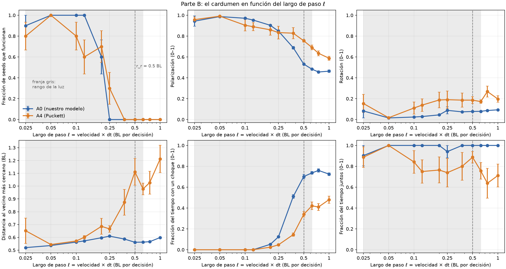
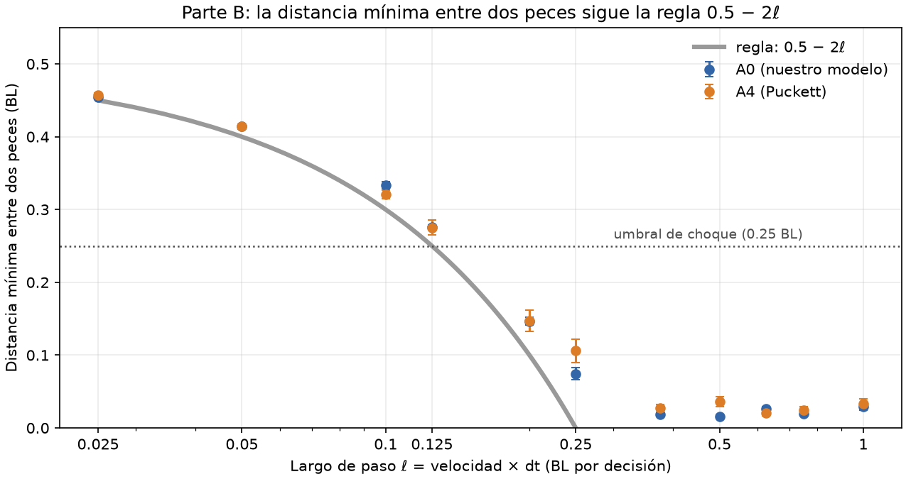
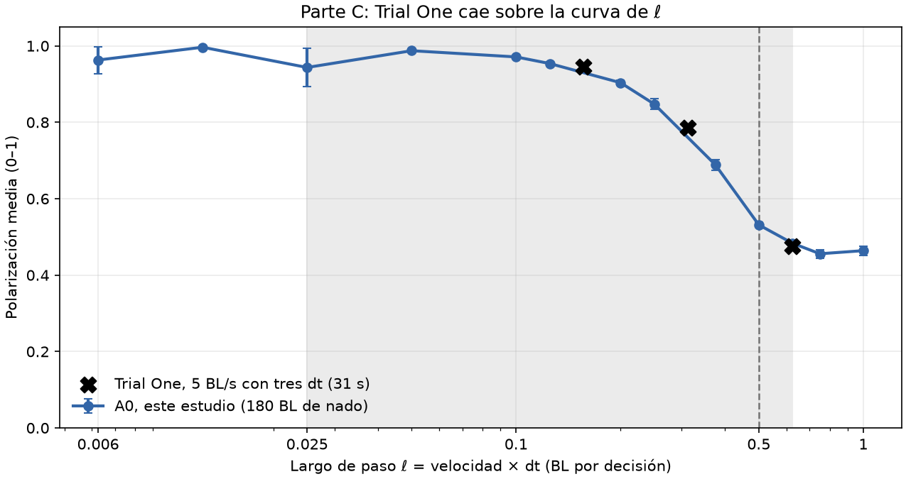

# Estudio 3 — Empujar dt y velocidad

## Pregunta

El comportamiento de los peces depende mucho de dt (su tiempo de reacción) y de su velocidad. ¿Qué patrón hay? Y si dejamos las mismas zonas de Couzin, ¿qué se mantiene igual entre distintos dt?

## ¿Tiene sentido este estudio? Sí, y hay un atajo

**Sí tiene sentido**, y además ya sabemos algo que lo simplifica mucho:

> Si el pez gira de golpe y no tiene ruido, el modelo **solo depende de ℓ = velocidad × dt**, es decir, de cuánto avanza el pez entre dos decisiones.

**¿Por qué?** En cada decisión el pez mira dónde están los demás y avanza ℓ. Los segundos no aparecen en ninguna regla. Por eso (1 BL/s, dt 0.25 s), (2 BL/s, dt 0.125 s) y (0.5 BL/s, dt 0.5 s) dan **exactamente las mismas trayectorias**: en las tres, ℓ = 0.25 BL. Ya lo comprobamos con el código del notebook y la diferencia fue cero. Lo único que cambia es cuántos segundos "dura" cada decisión.

**Consecuencia:** en vez de una tabla gigante de dt × velocidad, basta con mover ℓ.

**¿Qué "parámetros mínimos" se mantienen iguales?** Son proporciones sin unidades. Si dos configuraciones tienen las mismas proporciones, se comportan igual:

| Proporción | Qué significa |
|---|---|
| ℓ / r_r | cuánto avanza el pez comparado con su zona de repulsión |
| r_o / r_r y r_a / r_r | el tamaño de las zonas comparadas entre sí |
| giro máximo por decisión | cuánto puede girar cada vez que decide |
| ruido por decisión | cuánto se equivoca cada vez que decide |
| N y arena / r_a | cuántos peces hay y cuánto espacio tienen |

---

## Parte A — Comprobar el atajo con el modelo real

1. **Mismo ℓ, mismo comportamiento.** Probamos tres combinaciones con ℓ = 0.25 (las de arriba) y tres con ℓ = 0.375: (3 BL/s, 0.125 s), (1.5 BL/s, 0.25 s) y (6 BL/s, 0.0625 s). Las posiciones tienen que salir iguales, decisión por decisión.
2. **El giro y el ruido.** Si el giro máximo y el ruido se definen **por decisión**, como Puckett (1.75 rad y 0.01 rad por decisión), el atajo sigue valiendo. Si el giro se define **por segundo**, como los 14 rad/s de Trial Three, ya no vale. Lo mostramos con un ejemplo.
3. **Escalado.** Si multiplicamos por 2 todas las distancias (r_r, r_o, r_a, arena y ℓ), el comportamiento tiene que salir igual, porque solo importan las proporciones.

## Parte B — Barrer ℓ

- **Valores de ℓ:** 0.025, 0.05, 0.1, 0.125, 0.2, 0.25, 0.375, 0.5, 0.625, 0.75 y 1.0 BL por decisión. Con dt = 0.125 s, eso equivale a velocidades de 0.2 a 8 BL/s.
- **Configuraciones:** A0 (giro de golpe, sin ruido) y A4 (Puckett). En A4 el atajo también vale, porque el giro y el ruido se definen por decisión.
- **Duración:** en todas las corridas los peces nadan la misma distancia (180 BL), así que el número de decisiones es 180 / ℓ.
- **Medimos:** si funciona, polarización, rotación, distancia al vecino y choques.

**Qué esperamos:** cuando ℓ se acerca a r_r = 0.5 BL, un pez puede "saltarse" la zona de repulsión en una sola decisión. Ahí deberían aparecer choques y el grupo debería empezar a romperse. Queremos encontrar **el valor de ℓ en el que el cardumen deja de funcionar**.

## Parte C — Relacionarlo con los trials y con la luz

- **Trials:** Trial Three usó velocidades de 1, 3 y 5 BL/s con dt entre 0.0078 y 0.031 s, es decir, ℓ entre 0.008 y 0.156 BL. Ubicamos esos resultados en la curva de ℓ para entender por qué cambiaban.
- **Luz:** con dt = 0.125 s y la velocidad entre 0.2 y 5 BL/s, ℓ va de 0.025 a 0.625 BL. La parte B nos dice si el cardumen funciona en todo ese rango. Si se rompe con ℓ grande, hay que decidir qué hacer **antes** de la luz: por ejemplo, reportarlo como limitación o poner un límite a la velocidad máxima. Esa decisión hay que documentarla.

## Qué esperamos (según los papers)

En golden shiners reales, más velocidad lleva a estados más ordenados, milling o polarizado (Tunstrøm et al. 2013). Queremos ver si en nuestro modelo un ℓ más grande también da más orden, hasta el punto en que se rompe.

---

## Resultados

Cuaderno: [`study_03.ipynb`](study_03.ipynb). Datos: `data/results.csv` (260 simulaciones).

### Parte A — El atajo se cumple exactamente

| Prueba | Mayor diferencia de posición entre las dos corridas |
|---|---|
| Mismo ℓ = 0.25 BL: (1 BL/s, 0.25 s), (2 BL/s, 0.125 s) y (0.5 BL/s, 0.5 s) | **0.0 BL** |
| Mismo ℓ = 0.375 BL: (3 BL/s, 0.125 s), (1.5 BL/s, 0.25 s) y (6 BL/s, 0.0625 s) | **0.0 BL** |
| Giro y ruido **por decisión** (1.75 rad y 0.01 rad, como Puckett) | **0.0 BL** |
| Giro **por segundo** (14 rad/s, como Trial Three) | 16 a 25 BL: trayectorias totalmente distintas |
| Ruido **por segundo** (escalado con √dt) | 12 a 25 BL: trayectorias totalmente distintas |
| Todas las distancias × 2 (radios, arena y ℓ) | **0.0 BL**: el mismo cardumen, el doble de grande |

Todo con 10 seeds, en A0 (con el `shiner_model.py` compartido) y en A4, comparando posición por posición después de cada decisión. Es una igualdad exacta, no aproximada.

**Qué significa:** el modelo no "sabe" cuánto dura un segundo. Solo importan las proporciones: ℓ/r_r, r_o/r_r, r_a/r_r, el giro y el ruido por decisión, N y arena/r_a. Por eso hay que definir el giro y el ruido **por decisión**, como Puckett; definidos por segundo, como en Trial Three, el atajo se rompe.

### Parte B — Barrer ℓ

| ℓ (BL por decisión) | Velocidad con dt = 0.125 s | A0: funciona | A0: polarización | A0: tiempo con choque | A4: funciona | A4: polarización | A4: tiempo con choque |
|---|---|---|---|---|---|---|---|
| 0.025 | 0.2 BL/s | 9/10 | 0.94 | 0 % | 8/10 | 0.96 | 0 % |
| 0.05 | 0.4 BL/s | 10/10 | 0.99 | 0 % | 10/10 | 0.99 | 0 % |
| 0.1 | 0.8 BL/s | 10/10 | 0.97 | 0 % | 8/10 | 0.90 | 0 % |
| **0.125** | **1 BL/s** | **10/10** | 0.95 | 0 % | 6/10 | 0.89 | 0 % |
| 0.2 | 1.6 BL/s | 6/10 | 0.90 | 5 % | 7/10 | 0.86 | 2 % |
| 0.25 | 2 BL/s | 0/10 | 0.85 | 12 % | 3/10 | 0.83 | 5 % |
| 0.375 | 3 BL/s | 0/10 | 0.69 | 51 % | 0/10 | 0.83 | 15 % |
| 0.5 | 4 BL/s | 0/10 | 0.53 | 70 % | 0/10 | 0.76 | 34 % |
| 0.625 | 5 BL/s | 0/10 | 0.48 | 74 % | 0/10 | 0.69 | 42 % |
| 0.75 | 6 BL/s | 0/10 | 0.46 | 76 % | 0/10 | 0.64 | 41 % |
| 1.0 | 8 BL/s | 0/10 | 0.46 | 73 % | 0/10 | 0.59 | 48 % |

"Tiempo con choque" = fracción del último tercio en la que algún par de peces está a menos de 0.25 BL. Para "funcionar" tiene que ser como máximo 5 %.

**Lo que se ve:**

1. **Hasta ℓ = 0.125 BL no hay ni un solo choque.** Desde ℓ = 0.2 empiezan, y desde ℓ = 0.25 el cardumen ya no "funciona" por culpa de los choques.
2. **Hay una regla simple detrás:** dos peces que nadan uno hacia el otro se acercan hasta 2ℓ en una decisión. Si empiezan justo afuera de la zona de repulsión (0.5 BL), pueden quedar a **0.5 − 2ℓ** antes de reaccionar. Es el peor caso (dos peces de frente), y la distancia mínima medida queda siempre justo encima de esa regla (0.41 BL con ℓ = 0.05, 0.33 con 0.1, 0.28 con 0.125, 0.15 con 0.2). La regla cruza el umbral de choque (0.25 BL) en **ℓ = 0.125 BL**, que es justo nuestro modelo a 1 BL/s.
3. **Con ℓ grande, el grupo se desordena.** En A0, la polarización baja de 0.95 a 0.48 y el grupo pasa a ser un *swarm* desde ℓ = 0.5 BL. A4 (con giro limitado, punto ciego y ruido) aguanta más orden (0.69 con ℓ = 0.625) y tiene menos choques, pero tampoco funciona.
4. **En A4, los fallos con ℓ chico no son choques:** son grupos que todavía no se juntaron en la arena de 28 BL (lo mismo que en los estudios 1 y 2).

### Parte C — Los trials y la luz sobre la curva

| Trial | Velocidades | dt (s) | ℓ (BL por decisión) |
|---|---|---|---|
| Trial One (notebook 04) | 1 y 5 BL/s | 0.125, 0.0625, 0.03125 | 0.031–0.625 |
| Trial Two (notebook 02) | 1, 3 y 5 BL/s | 0.0625, 0.03125, 0.015625 | 0.016–0.31 |
| Trial Three | 1, 3 y 5 BL/s | 0.0078–0.031 | 0.008–0.156 |
| Luz (plan) | 0.2–5 BL/s | 0.125 | 0.025–0.625 |

- **Trial One cae sobre nuestra curva.** A 5 BL/s con tres dt midió polarización 0.476, 0.785 y 0.945, es decir, ℓ = 0.625, 0.3125 y 0.156. Nuestra curva de A0 da 0.48 con ℓ = 0.625, entre 0.85 y 0.69 alrededor de 0.31, y entre 0.95 y 0.90 alrededor de 0.16. Los tres puntos están sobre la curva (figura abajo).
- **Por qué los trials no "convergían":** al achicar dt, los trials movían ℓ. Con ℓ chico la polarización casi no cambia (0.94–0.99 desde 0.006 hasta 0.125 BL), pero la forma del grupo sí: la distancia al centro de los grupos juntos pasa de 0.97 BL (ℓ = 0.05) a 1.12 (0.125) y 1.24 (0.2), que son cambios del 15 al 30 %. Trial Three falló justo por cambios así en la distancia al centro. No era un error numérico: era otro comportamiento.

Para ver la curva en los ℓ de Trial Three agregamos dos valores extra (0.00625 y 0.0125 BL; no estaban en el README). En A0 dan 9/10 y 10/10.

## Conclusión

- **¿Se confirma que solo importa ℓ?** **Sí, exactamente** (diferencia 0.0), siempre que el giro y el ruido se definan **por decisión**. Definidos por segundo, como en Trial Three, deja de valer.
- **¿Hasta qué ℓ funciona el cardumen?** Sin choques, **hasta ℓ = 0.125 BL** (A0: 10/10). Con ℓ = 0.2 funciona a medias (6/10), y desde ℓ = 0.25 no funciona, porque los peces se chocan. La regla que lo explica es: distancia mínima ≈ 0.5 − 2ℓ.
- **¿Qué significa para la luz?** Con dt = 0.125 s y la velocidad entre 0.2 y 5 BL/s, ℓ va de 0.025 a 0.625 BL. **Solo la parte lenta (hasta unos 1–1.6 BL/s) da un cardumen sin choques.** En las zonas brillantes (rápidas) los peces se van a chocar y el grupo va a estar menos ordenado. Ojo: en golden shiners reales pasa lo contrario, nadar más rápido da **más** orden (Tunstrøm et al. 2013). Esto es una limitación del modelo con 8 decisiones por segundo, no de los peces.

**Decisión que hay que tomar antes de la luz** (no la tomamos nosotros; aquí van las opciones):

| Opción | A favor | En contra |
|---|---|---|
| A. Dejar el modelo de Puckett tal cual (0.2–5 BL/s, 8 decisiones/s) y **reportar los choques** como limitación | Es el modelo del paper que queremos reproducir. Puckett et al. (2018, p. 6) también vieron vecinos a menos de 0.5 BL (con 128 peces o más) y lo atribuyen al hacinamiento y a la "baja resolución temporal" | Las zonas brillantes tienen choques y menos orden |
| B. Poner una **velocidad máxima** de unos 1.6 BL/s (ℓ ≤ 0.2) | Casi sin choques | La luz cambia la velocidad 8 veces en vez de 25 (ya no es Puckett) |
| C. Que el pez **decida más seguido cuando va más rápido** (ℓ fijo) | Nunca hay choques | Ningún paper lo hace; es una regla nueva |

Nuestra sugerencia: **A como modelo principal**, midiendo siempre el tiempo con choque, y **B como prueba de robustez** para ver si las conclusiones sobre la luz cambian.
