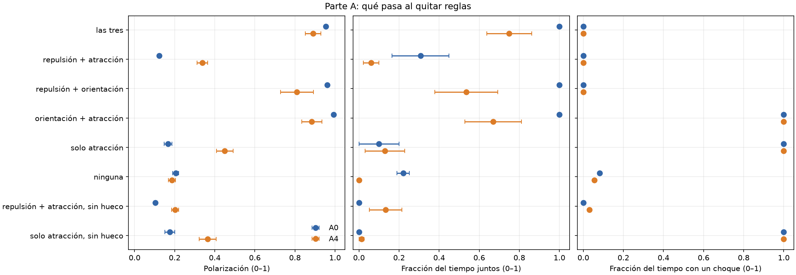
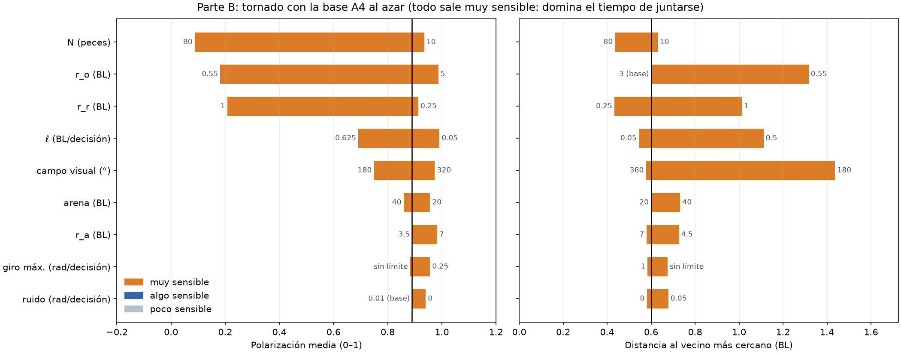
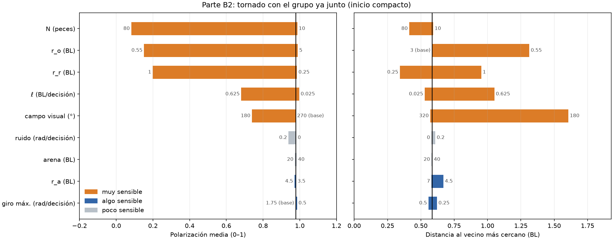
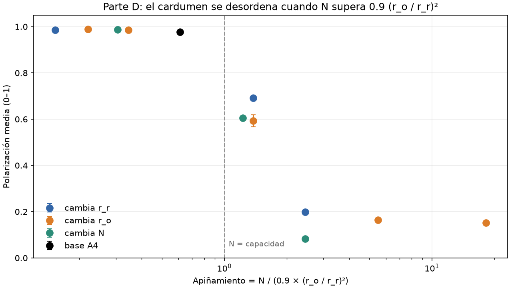

# Estudio 4 — Lo mínimo que necesitan los peces y qué es sensible

## Preguntas

1. ¿Qué reglas son **imprescindibles** para que haya cardumen?
2. ¿Qué parámetros cambian mucho el comportamiento (**sensibles**) y cuáles casi no lo cambian?
3. ¿Cuál es el **modelo más simple** que sigue funcionando?

---

## Parte A — Quitar reglas

Usamos las configuraciones A0 y A4 del estudio 1, con 10 seeds.

| Reglas activas | Qué esperamos |
|---|---|
| las tres | cardumen |
| repulsión + atracción | swarm, es decir, juntos pero desordenados (Couzin). Katz dice que la alineación podría salir sola |
| repulsión + orientación | se alinean, pero el grupo se separa porque nada los junta |
| orientación + atracción (sin repulsión) | se amontonan y chocan |
| solo atracción | se amontonan en un punto |
| ninguna | cada pez por su lado |

## Parte B — Sensibilidad: un parámetro a la vez

- **Base:** la configuración A4 (Puckett), con N = 20 y velocidad 1 BL/s.
- Cambiamos un solo parámetro y dejamos el resto igual.

| Parámetro | Valores |
|---|---|
| r_r (repulsión) | 0.25, 0.5, 0.75 y 1.0 BL |
| r_o (orientación) | 0.55, 1, 2, 3, 4 y 5 BL |
| r_a (atracción) | 3.5, 4.5, 5.5, 7 y 9 BL |
| campo visual | 180°, 230°, 270°, 320° y 360° |
| giro máximo por decisión | 0.25, 0.5, 1.0 y 1.75 rad, y sin límite |
| ruido por decisión | 0, 0.01, 0.05, 0.1 y 0.2 rad |
| N | 10, 20, 40 y 80 peces |
| ℓ | se toma del estudio 3 |
| tamaño de arena | se toma del estudio 2 |

Los rangos salen de los valores que probaron los papers (por ejemplo, la tabla 1 de Couzin 2002).

**¿Cómo medimos la sensibilidad?** Para cada parámetro, buscamos el cambio más grande de cada métrica dentro de su rango, y lo clasificamos así:

| Clase | Criterio |
|---|---|
| **muy sensible** | cambia el resultado de funciona / no funciona, o alguna métrica cambia más de 0.2 |
| **algo sensible** | el cambio está entre 0.05 y 0.2 |
| **poco sensible** | el cambio es menor que 0.05 |

Para las distancias usamos el cambio relativo: más del 40 % es muy sensible, entre 10 % y 40 % es algo sensible, y menos del 10 % es poco sensible.

Con esto hacemos un **gráfico "tornado"**: una barra por parámetro, ordenadas de la que más cambia a la que menos.

## Parte C — El modelo mínimo

1. Juntamos las reglas imprescindibles (parte A) con los parámetros sensibles (parte B).
2. Los parámetros poco sensibles los dejamos en el valor de los papers o en el más simple.
3. Comprobamos con 10 seeds **nuevas** (10–19) que el modelo mínimo sigue funcionando.

Resultado: una tabla final de **"parámetros clave para la fase de luz"**.

---

## Resultados

Cuaderno: [`study_04.ipynb`](study_04.ipynb). Datos: `data/results.csv` (880 simulaciones), `data/sensitivity_classes.csv` y `data/sensitivity_classes_compact.csv`.

### Parte A — Quitar reglas

| Reglas activas | A0: funciona | A0: polarización | A0: tiempo juntos | A4: funciona | A4: polarización | A4: tiempo juntos | Choques | Qué esperábamos | Qué pasó |
|---|---|---|---|---|---|---|---|---|---|
| las tres | **10/10** | 0.95 | 100 % | 6/10 | 0.89 | 75 % | no | cardumen | cardumen (en A4, 4 seeds todavía no se habían juntado) |
| repulsión + atracción | 0/10 | 0.12 | 31 % | 0/10 | 0.34 | 6 % | no | swarm | **varios swarms separados** |
| repulsión + orientación | **10/10** | 0.96 | 100 % | 5/10 | 0.81 | 54 % | no | se alinean pero se separan | **se alinean y siguen juntos** |
| orientación + atracción | 0/10 | 0.99 | 100 % | 0/10 | 0.88 | 67 % | **todo el tiempo** | se amontonan y chocan | igual: muy ordenados, pero encimados (vecino a 0.07–0.18 BL) |
| solo atracción | 0/10 | 0.17 | 10 % | 0/10 | 0.45 | 13 % | **todo el tiempo** | se amontonan en un punto | chocan y además se separan |
| ninguna | 0/10 | 0.21 | 22 % | 0/10 | 0.19 | 0 % | pocos | cada pez por su lado | igual |
| repulsión + atracción, sin hueco (extra) | 0/10 | 0.10 | 0 % | 0/10 | 0.20 | 13 % | no | swarm (Couzin) | grupitos muy apretados que nunca se juntan |
| solo atracción, sin hueco (extra) | 0/10 | 0.18 | 0 % | 0/10 | 0.36 | 1 % | **todo el tiempo** | se amontonan en un punto | sí, en varios puntos |

"Sin hueco": r_o = 0.51 BL, así que la atracción empieza justo después de la repulsión (en las filas normales, apagar la orientación deja una zona "muda" de 0.5 a 3 BL).

**Lo más interesante:** sin orientación **nunca** hay cardumen, ni siquiera sin hueco. Los peces forman grupitos que casi no se mueven (no van hacia ningún lado), así que no se encuentran entre ellos. Y al revés: con repulsión + orientación, sin atracción, el grupo ya alineado nada en paralelo y se queda junto.

### Parte B — Sensibilidad con la base A4 al azar (el plan del README)

Con el criterio del README, **los 9 parámetros salen "muy sensibles"**. El motivo es que la base está **en el borde**: funciona en 6 de 10 seeds, y las otras 4 todavía no se habían juntado al final de los 180 BL (ver estudio 2). Cualquier cambio que acelere o frene un poco el momento en que se juntan cambia el veredicto. Con esta base, el criterio mide sobre todo **cuánto tarda el grupo en juntarse**. No cambiamos el criterio (regla 5): lo reportamos así y agregamos la parte B2.

### Parte B2 (extra) — Sensibilidad con el grupo ya junto

La misma prueba, con la misma base A4 y el mismo criterio, pero con **inicio compacto**. Así empezaremos en la fase de luz (desde checkpoints ya juntos). La base funciona en 10/10.

| Parámetro | Clase | Qué cambia |
|---|---|---|
| r_r (repulsión) | **muy sensible** | 0.25 BL: choques (3/10 funcionan). 0.75 BL: polarización 0.69. 1 BL: *swarm* (0.20). |
| r_o (orientación) | **muy sensible** | 0.55 y 1 BL: *swarm* y grupos separados (0.15–0.16). 2 BL: 0.59. 3 a 5 BL: 0.98–0.99. |
| N (peces) | **muy sensible** | 10 y 20 peces: 0.98–0.99. 40: 0.61. 80: *swarm* (0.08) con choques el 58 % del tiempo. |
| ℓ (largo de paso) | **muy sensible** | hasta 0.2 BL: 10/10. 0.25: 2/10 (choques). 0.375 a 0.625: 0/10 (choques 21–39 %). |
| campo visual | **muy sensible**, pero **solo con 180°** | 180°: el grupo se separa (1/10). 230°: 9/10. 270° a 360°: 10/10. |
| r_a (atracción) | algo sensible | de 3.5 a 9 BL siempre funciona (10/10); solo cambia un poco la distancia al vecino (hasta +15 %). |
| giro máximo | algo sensible | 0.25 rad: algunos choques (8/10). De 0.5 rad a sin límite: 10/10, sin cambios. |
| ruido | poco sensible | de 0 a 0.2 rad: 10/10; la polarización solo baja de 0.98 a 0.94. |
| tamaño de arena | poco sensible | de 20 a 40 BL: 10/10, nada cambia. |

### Parte C — El modelo mínimo (seeds nuevas 10–19)

| Configuración | Funciona | Polarización | Vecino (BL) | Choques |
|---|---|---|---|---|
| Puckett completo (A4), inicio compacto | 10/10 | 0.98 | 0.58 | 0 % |
| **Mínimo:** 3 reglas, 360°, giro de golpe, sin ruido, inicio compacto | **10/10** | 0.97 | 0.58 | 0 % |
| Mínimo, pero inicio al azar | 6/10 | 0.87 | 0.59 | 0 % |
| Mínimo sin atracción | 10/10 | 0.98 | 0.57 | 0 % |
| Puckett sin atracción, inicio compacto, 540 BL | 10/10 | 0.98 | 0.59 | 0 % |
| Puckett completo, inicio compacto, 540 BL | 10/10 | 0.98 | 0.58 | 0 % |

El modelo mínimo funciona en las 10 seeds nuevas, igual que el de Puckett. Con inicio al azar, otra vez solo 6/10: el problema siempre es juntarse, no mantenerse.

**Sorpresa:** un grupo ya formado **tampoco necesita la atracción** para mantenerse junto, incluso con el ruido de Puckett y el triple de tiempo. La atracción sirve sobre todo para **encontrarse**: con inicio al azar, r_a = 3.5 BL deja muchos grupos sin juntar y r_a = 7 BL los junta a todos (parte B).

### Parte D (extra) — Una sola regla para r_r, r_o y N: el apiñamiento

- La atracción junta al grupo hasta que su diámetro es más o menos r_o.
- En un círculo de diámetro r_o caben unos **0.9 × (r_o / r_r)²** peces sin que ninguno invada la zona de repulsión de otro. Con r_r = 0.5 y r_o = 3 BL, son **unos 33 peces**.
- Si hay más, siempre hay alguno en la zona de repulsión. Como la repulsión tiene prioridad, ese pez deja de alinearse, y el grupo se vuelve un *swarm*.

**Apiñamiento** = N ÷ capacidad. Cambiar N, r_r o r_o es lo mismo si da el mismo apiñamiento:

| Apiñamiento | Ejemplos | Polarización |
|---|---|---|
| menos de 1 | base (0.61), 10 peces, r_r = 0.25, r_o = 4 o 5 | 0.98–0.99 |
| 1.2–1.4 | 40 peces (1.23), r_r = 0.75 (1.38), r_o = 2 (1.38) | 0.59–0.69 |
| 2.4 o más | 80 peces (2.45), r_r = 1 (2.45), r_o = 1 (5.5) | 0.08–0.20 |

Esta regla también explica el estudio 1: con 20 peces, el grupo necesita r_o ≥ 0.5 × √(20 / 0.9) ≈ 2.4 BL para ordenarse, y en el diagrama de Couzin el paso a polarizado aparece justo entre 2 y 3 BL. Y explica por qué 64 peces siempre forman un *swarm* (apiñamiento 2).

## Conclusión

- **Reglas imprescindibles:** **repulsión** (sin ella, los peces se enciman todo el tiempo) y **orientación** (sin ella no hay orden ni grupo). La **atracción** no hace falta para mantener un grupo ya formado, pero sí para **juntarse**, y la vamos a necesitar en la fase de luz: en el mecanismo de Berdahl y Puckett, la atracción hace que los peces rápidos (zona clara) sigan a los lentos (zona oscura).
- **Parámetros sensibles (hay que elegirlos con cuidado y justificarlos):**
  - r_r, r_o y N, que actúan juntos a través del **apiñamiento**: hay que mantener N por debajo de 0.9 × (r_o / r_r)², unos 33 peces con los valores de Puckett;
  - **ℓ = velocidad × dt**: el cardumen funciona hasta unos 0.2 BL por decisión, y los primeros choques aparecen después de 0.125 (ver estudio 3);
  - el **campo visual**, pero solo si baja de unos 230°.
- **Parámetros poco sensibles (se pueden dejar fijos):** ruido (0–0.2 rad), tamaño de arena (20–40 BL), giro máximo (desde 0.5 rad) y r_a (3.5–9 BL), siempre que el grupo empiece junto.
- **El modelo mínimo:** las tres reglas con r_r = 0.5, r_o = 3 y r_a = 5.5 BL, 20 peces, ℓ = 0.125 BL, arena de 28 BL, 360°, giro de golpe, sin ruido, y **empezando con el grupo junto**. Funciona en 10 de 10 seeds nuevas (10–19).

### Parámetros clave para la fase de luz

| Parámetro | Valor | Por qué |
|---|---|---|
| r_r | 0.5 BL | Puckett, tabla S1. Muy sensible: con 0.75 BL la polarización ya baja a 0.69. |
| r_o | 3 BL | Puckett, tabla S1. Muy sensible: con 20 peces necesita al menos 2.4 BL. |
| r_a | 5.5 BL | Puckett, tabla S1. Poco efecto con el grupo junto, pero ayuda a juntarse y es clave para la luz. |
| N | 20 | Apiñamiento 0.6, lejos del límite (unos 33). Con 40 o más peces el modelo da *swarm*. |
| dt | 0.125 s | Puckett, tabla S1 (8 decisiones por segundo). |
| Velocidad | 0.2–5 BL/s (luz) | ℓ = 0.025–0.625 BL. Funciona solo hasta ℓ ≈ 0.2 (unos 1.6 BL/s): hay que decidir qué hacer con la parte rápida (ver estudio 3). |
| Campo visual | 270° (Puckett) | Da lo mismo desde 230°; usamos el valor del paper. |
| Giro máximo | 1.75 rad por decisión (Puckett) | Casi no cambia nada. Además, con ℓ grande el modelo de Puckett completo tiene menos choques que A0 (estudio 3). |
| Ruido | 0.01 rad por decisión (Puckett) | No importa hasta 0.2 rad; usamos el valor del paper. |
| Arena | 28 BL (Puckett) | No importa con el grupo ya junto. |
| Inicio | grupo ya junto (checkpoints) | Con inicio al azar, en 180 BL el 40 % de los grupos todavía no se juntó. |
