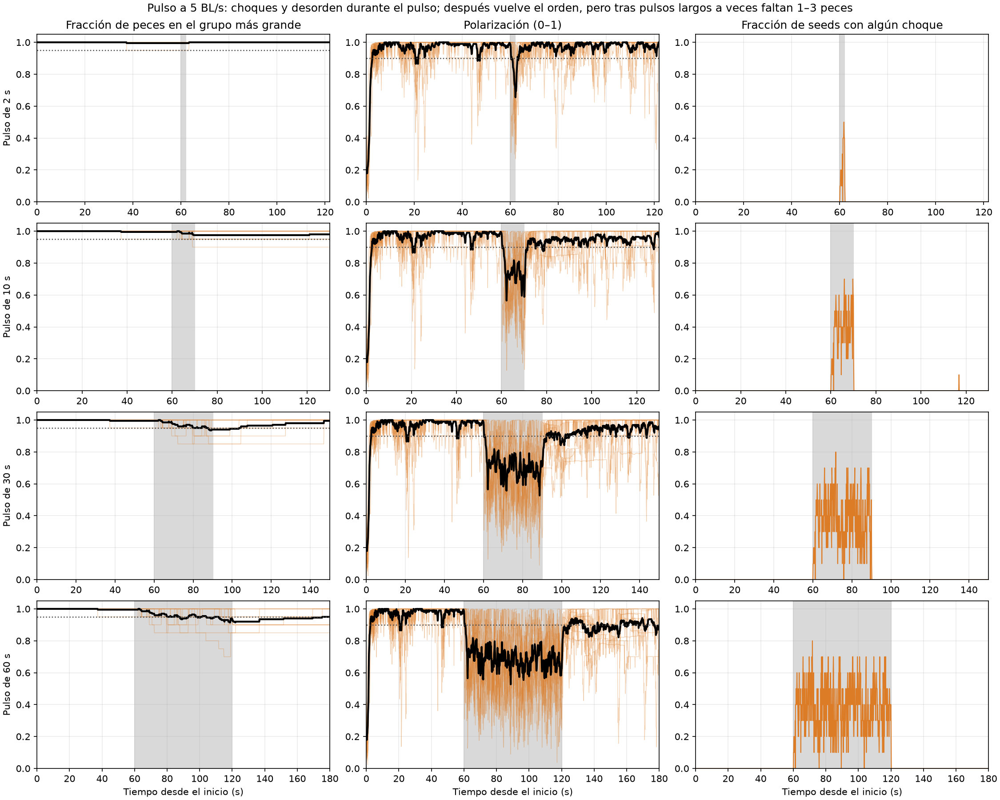
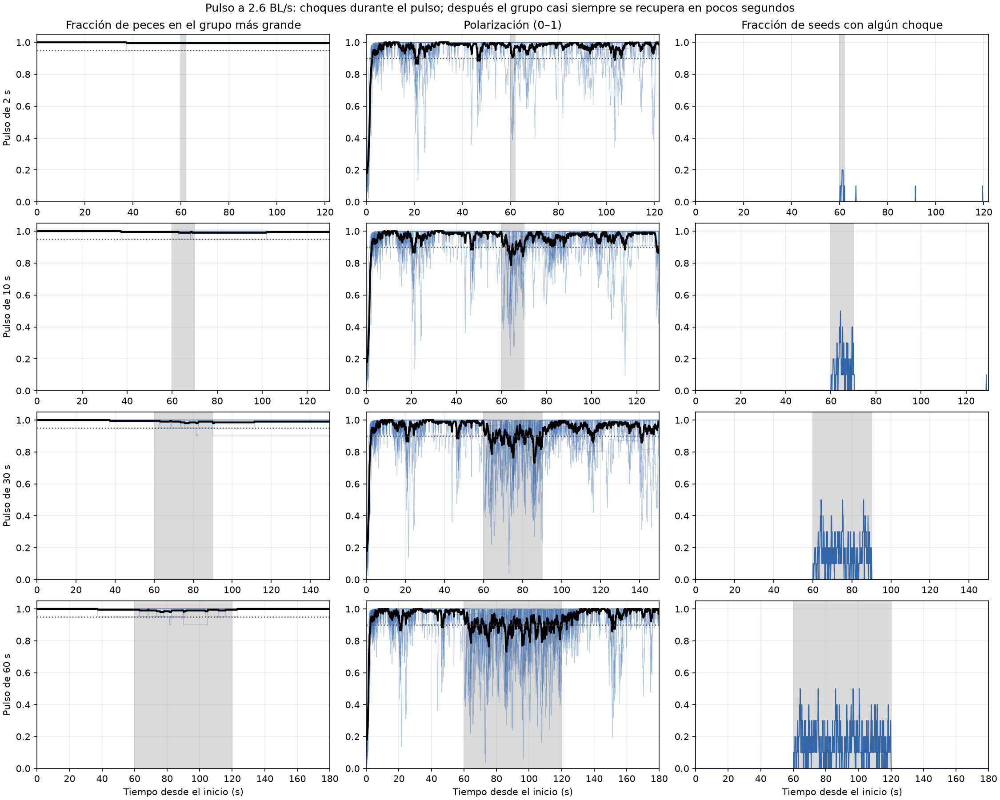
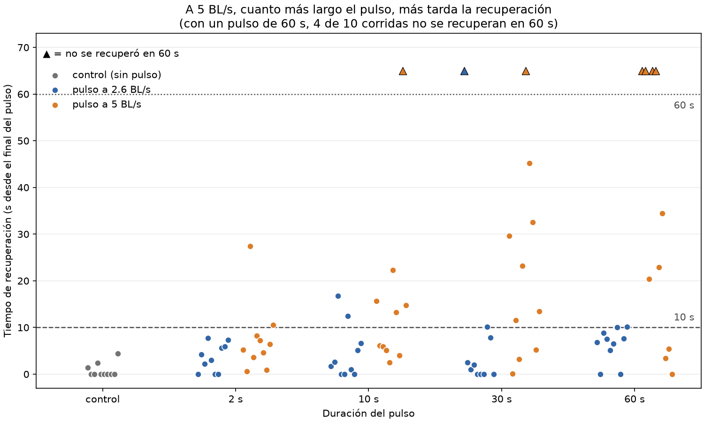
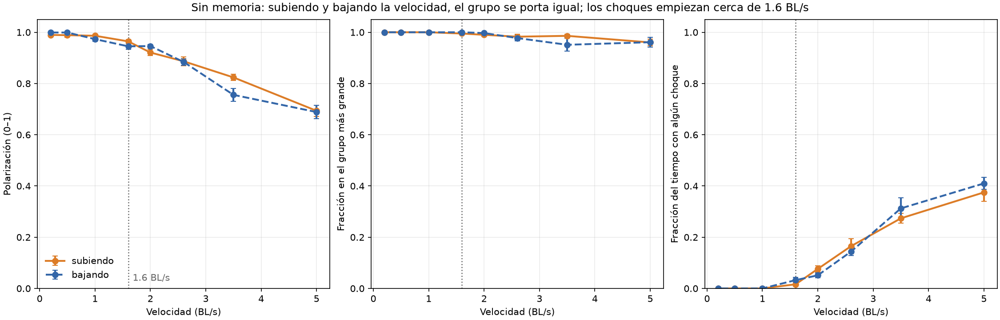

# Estudio 5 — Pulso de velocidad: ¿hace falta la opción C?

## Pregunta

En la fase de luz, los peces van a nadar rápido en las zonas claras (hasta 5 BL/s). El estudio 3 mostró que a esa velocidad, con 8 decisiones por segundo, los peces se chocan y el grupo se desordena.

¿Ese daño es **pasajero** (el grupo se recupera cuando vuelve a ir lento) o **permanente** (el grupo se rompe y no se vuelve a juntar)?

## ¿Por qué?

Para la parte rápida de la luz hay tres opciones (estudio 3):

| Opción | Qué hace |
|---|---|
| A | Dejar el modelo de Puckett tal cual y reportar los choques |
| B | Poner una velocidad máxima de 1.6 BL/s |
| C | Que el pez decida más seguido cuando va rápido, para no avanzar nunca más de 0.125 BL entre decisiones |

C es la más difícil de programar. Pero **no hace falta programarla para saber qué da**: con ℓ fijo, el grupo se porta igual a cualquier velocidad (estudio 3). Lo que no sabemos es **qué tan grave es A**. Esta prueba lo mide.

En el mecanismo de Berdahl y Puckett, el grupo pasa la mayor parte del tiempo en las zonas oscuras (lentas); las zonas claras son de paso. Por eso la pregunta importante no es "¿funciona a 5 BL/s para siempre?" (ya sabemos que no), sino **"¿se recupera después de pasar un rato rápido?"**.

---

## Parte A — El pulso

**Modelo:** el de Puckett (A4): 20 peces, r_r = 0.5, r_o = 3 y r_a = 5.5 BL, campo visual de 270°, giro máximo de 1.75 rad y ruido de 0.01 rad por decisión, arena de 28 × 28 BL y dt = 0.125 s.

**Inicio:** con el grupo junto (en el 25 % central de la arena), como vamos a empezar en la fase de luz.

**Cada corrida tiene tres partes:**

| Parte | Velocidad | Duración | Decisiones |
|---|---|---|---|
| 1. Calentamiento | 1 BL/s | 60 s | 480 |
| 2. Pulso | 2.6 o 5 BL/s | 2, 10, 30 o 60 s | 16, 80, 240 o 480 |
| 3. Recuperación | 1 BL/s | 60 s | 480 |

**Control:** las mismas corridas sin pulso (siempre a 1 BL/s). Sirve para ver cuánto "falla" el criterio por puro azar.

**Total:** 2 velocidades × 4 duraciones + el control = 9 configuraciones, con 10 seeds cada una = 90 corridas.

**Medimos en cada decisión:**
- si hay algún choque (algún par de peces a menos de 0.25 BL);
- la polarización;
- la fracción de peces en el grupo más grande (dos peces están unidos si están a menos de r_a);
- la distancia mínima entre dos peces.

### ¿Cuándo decimos que el grupo "se recuperó"?

Cuando, durante **5 segundos seguidos** (40 decisiones), se cumplen las tres cosas a la vez:
- el grupo más grande tiene al menos 19 de los 20 peces (95 %);
- la polarización es de 0.9 o más;
- no hay ningún choque.

**Tiempo de recuperación** = los segundos que pasan desde que termina el pulso hasta que empiezan esos 5 segundos.

Si al final del calentamiento algún seed todavía no cumple esto, se reporta aparte (no se borra).

### Regla para decidir (fijada antes de correr)

| Qué pasa | Decisión |
|---|---|
| Con 2.6 y con 5 BL/s, y para todas las duraciones, al menos 9 de 10 seeds se recuperan en 10 s o menos | **A es suficiente.** Los choques son pasajeros. C queda solo como prueba opcional en la fase de luz |
| En alguna combinación, 2 seeds o más **no** se recuperan en 60 s | **A tiene un problema real.** Hay que preparar C (o B) junto con la luz |
| Cualquier otro caso | **Zona gris.** Lo reportamos y lo decidimos en grupo |

Antes de correr los pulsos se corre el control. Si en el control menos de 9 de 10 seeds cumplen el criterio, el criterio es demasiado estricto: el agente para y nos avisa, y no lo cambia por su cuenta.

## Parte B — Memoria con velocidad (subir y bajar)

Es el experimento de memoria del estudio 1, pero cambiando la velocidad en vez de r_o.

- Mismo modelo y mismo inicio. Calentamiento de 60 s a 0.2 BL/s.
- En **una sola simulación larga**, la velocidad sube por 0.2, 0.5, 1, 1.6, 2, 2.6, 3.5 y 5 BL/s, y después baja por los mismos valores.
- 30 s (240 decisiones) en cada valor; medimos el último tercio de cada valor.
- 10 seeds.
- Gráfico: polarización, fracción del grupo más grande y tiempo con choque en función de la velocidad, subiendo (línea llena) y bajando (línea punteada).

**Cómo se lee:**
- Si las curvas de subida y de bajada **coinciden**, no hay memoria: el grupo solo depende de la velocidad del momento. Eso es bueno para A.
- Si al bajar el grupo **sigue roto** a velocidades lentas, hay una memoria "mala": el daño de ir rápido dura. Eso es malo para A.

La parte B es para entender mejor; la decisión se toma con la regla de la parte A.

## Lo que esta prueba no puede ver

En la prueba, todos los peces van a la misma velocidad. Con luz, los peces de un mismo grupo van a velocidades distintas (los del lado claro, más rápido). Eso solo se puede probar con la luz implementada. Por eso, si C hace falta, se programa junto con la luz.

---

## Resultados

Todo está en `study_05.ipynb`: 90 corridas en la parte A, 10 en la parte B y 7 corridas extra, en unos 3 minutos de cálculo en total.

**Interpretaciones fijadas antes de correr** (las reglas del README no cambian):

- Los 40 momentos buenos tienen que caber dentro de los 60 s de recuperación. Por eso el tiempo de recuperación más largo posible es 55 s.
- La regla de decisión cuenta **las 10 seeds** de cada combinación, también las que no estaban listas al empezar el pulso.
- En la mediana, una corrida que no se recuperó cuenta como la más lenta.

### El control (sin pulso)

- **10 de 10 seeds se recuperan en 10 s**, así que el criterio no es demasiado estricto y seguimos con los pulsos.
- **8 de 10 seeds estaban listas** al final del calentamiento. Las seeds 0 y 1 no lo estaban. El calentamiento es igual en todas las configuraciones (mismo seed, mismos números al azar), así que **son siempre las mismas dos seeds (0 y 1)**.
- En el control, los tiempos van de 0 a 4.4 s. No son siempre 0 porque **la polarización baja un momento cuando el grupo llega a una pared**:
  - con algún pez a menos de 1 BL de una pared, la polarización está por debajo de 0.9 en el 18 % de los momentos;
  - lejos de las paredes, solo en el 0.8 %.
- Conclusión: un tiempo de recuperación de menos de unos 5 s es ruido.

### Tabla de la decisión

| Configuración | Listas al empezar | Recuperadas en 10 s | Recuperadas en 60 s | Mediana del tiempo | Tiempo con choque en el pulso |
|---|---|---|---|---|---|
| control (sin pulso) | 8/10 | 10/10 | 10/10 | 0.0 s | – |
| 2.6 BL/s, 2 s | 8/10 | 10/10 | 10/10 | 3.6 s | 10 % |
| 2.6 BL/s, 10 s | 8/10 | **8/10** | 10/10 | 2.2 s | 17 % |
| 2.6 BL/s, 30 s | 8/10 | **8/10** | 9/10 | 1.5 s | 17 % |
| 2.6 BL/s, 60 s | 8/10 | 9/10 | 10/10 | 7.2 s | 16 % |
| 5 BL/s, 2 s | 8/10 | **8/10** | 10/10 | 5.8 s | 25 % |
| 5 BL/s, 10 s | 8/10 | **5/10** | 9/10 | 9.7 s | 38 % |
| 5 BL/s, 30 s | 8/10 | **3/10** | 9/10 | 18.4 s | 38 % |
| 5 BL/s, 60 s | 8/10 | **3/10** | **6/10** | 28.7 s | 38 % |

**Fila de la regla que se cumple: "A tiene un problema real".** Con 5 BL/s durante 60 s, **4 de 10 seeds no se recuperan en 60 s**, y la regla permite como máximo 1. La fila "A es suficiente" tampoco se cumple: en 6 de las 8 combinaciones se recuperan en 10 s menos de 9 de 10 seeds.

Si contamos solo las 8 seeds que estaban listas, la decisión es la misma: con 5 BL/s durante 60 s, 2 de 8 no se recuperan en 60 s.

**Qué tan grave es el pulso** (medias de las 10 seeds, durante el pulso):

| Pulso | Tiempo con choque | Distancia mínima entre dos peces | Fracción mínima del grupo más grande | Polarización media |
|---|---|---|---|---|
| 2.6 BL/s, 2 s | 10 % | 0.41 BL | 0.995 | 0.94 |
| 2.6 BL/s, 10 s | 17 % | 0.05 BL | 0.985 | 0.90 |
| 2.6 BL/s, 30 s | 17 % | 0.03 BL | 0.970 | 0.89 |
| 2.6 BL/s, 60 s | 16 % | 0.02 BL | 0.960 | 0.89 |
| 5 BL/s, 2 s | 25 % | 0.14 BL | 0.995 | 0.84 |
| 5 BL/s, 10 s | 38 % | 0.04 BL | 0.960 | 0.75 |
| 5 BL/s, 30 s | 38 % | 0.02 BL | 0.905 | 0.71 |
| 5 BL/s, 60 s | 38 % | 0.02 BL | 0.865 | 0.69 |

Una distancia mínima de 0.02 BL quiere decir que **dos peces quedan casi uno encima del otro**: el modelo no impide que se atraviesen.

### Figuras

**Figura 1 — durante y después del pulso** (una fila por duración; banda gris = el pulso):

**Figura 2 — tiempo de recuperación de cada corrida** (▲ = no se recuperó en 60 s):

**Figura 3 — memoria con la velocidad** (línea llena = subiendo, punteada = bajando):

### Extra (no estaba en el README): ¿por qué no se recuperaron, y se recuperan más tarde?

Las 7 corridas que no se recuperaron en 60 s **no tenían el grupo roto**: les faltaban 1 a 3 peces (el grupo más grande tenía 17 o 18 de los 20), y casi no había choques. Las repetimos con una recuperación de **300 s**. Con el mismo seed, los primeros 60 s son idénticos a la corrida original (lo comprobamos):

| Pulso | Seed | Peces en el grupo grande a los 60 s | Se recupera a los… | Peces en el grupo grande a los 300 s |
|---|---|---|---|---|
| 2.6 BL/s, 30 s | 0 | 18 | 156 s | 20 |
| 5 BL/s, 10 s | 8 | 18 | 75 s | 20 |
| 5 BL/s, 30 s | 5 | 20 | 70 s | 20 |
| 5 BL/s, 60 s | 0 | 18 | 111 s | 20 |
| 5 BL/s, 60 s | 1 | 17 | 167 s | 20 |
| 5 BL/s, 60 s | 3 | 18 | 76 s | 20 |
| 5 BL/s, 60 s | 4 | 18 | 154 s | 20 |

**Todas se recuperan, entre 70 y 167 s después del pulso.** El daño no es permanente: es lento, porque los peces sueltos tardan en volver a encontrar al grupo. Este extra **no cambia la decisión**, porque la regla usa 60 s.

### Parte B — subir y bajar la velocidad

Medias de las 10 seeds en el último tercio de cada valor:

| Velocidad (BL/s) | Polarización subiendo | Polarización bajando | Grupo más grande subiendo | Grupo más grande bajando | Tiempo con choque subiendo | Tiempo con choque bajando |
|---|---|---|---|---|---|---|
| 0.2 | 0.99 | 1.00 | 1.00 | 1.00 | 0 % | 0 % |
| 0.5 | 0.99 | 1.00 | 1.00 | 1.00 | 0 % | 0 % |
| 1.0 | 0.99 | 0.97 | 1.00 | 1.00 | 0 % | 0 % |
| 1.6 | 0.96 | 0.95 | 1.00 | 1.00 | 2 % | 3 % |
| 2.0 | 0.92 | 0.95 | 0.99 | 1.00 | 8 % | 5 % |
| 2.6 | 0.89 | 0.88 | 0.98 | 0.98 | 17 % | 14 % |
| 3.5 | 0.82 | 0.76 | 0.99 | 0.95 | 27 % | 31 % |
| 5.0 | 0.69 | 0.69 | 0.96 | 0.96 | 38 % | 41 % |

- **Las dos curvas coinciden: no hay memoria.** El grupo solo depende de la velocidad del momento.
- La única diferencia es a 3.5 BL/s bajando, justo después de 60 s a 5 BL/s: hay un poco menos de orden. A 2 BL/s ya no queda nada de esa diferencia.
- Al volver a 0.5 y 0.2 BL/s, la polarización es 0.999, incluso un poco más alta que al subir (al subir, el grupo recién se había formado).
- **Los choques empiezan cerca de 1.6 BL/s** (2–3 % del tiempo), como en el estudio 3.

## Conclusión

- **¿El grupo se recupera después de ir rápido? ¿Cuánto tarda?**
  - **Sí, siempre**: en la prueba extra de 300 s todas las corridas se recuperan.
  - Después de un pulso a **2.6 BL/s**, casi siempre en menos de 10 s (mediana de 1.5 a 7 s).
  - Después de un pulso a **5 BL/s**, cuanto más largo el pulso, más tarda: mediana de 6 s (pulso de 2 s), 10 s (10 s), 18 s (30 s) y 29 s (60 s).
  - Cuando tarda mucho, el grupo no está roto: les faltan 1 a 3 peces sueltos, que vuelven en 1 a 3 minutos.
- **¿Hay memoria con la velocidad?** **No.** Subiendo y bajando, el grupo se porta igual. El daño de ir rápido no dura una vez que el grupo vuelve a ir lento.
- **Decisión, según la regla: A tiene un problema real. Hay que preparar C (o B) junto con la luz.** La fila que se cumple es la de "2 seeds o más no se recuperan en 60 s" (4 de 10, con 5 BL/s durante 60 s).

**Qué salió bien:**

- El control pasa (10/10), así que el criterio sirve.
- A 2.6 BL/s el grupo aguanta bien.
- No hay memoria.
- Los peces sueltos siempre vuelven.

**Qué salió mal:**

- A 5 BL/s hay choques en el 25–38 % del pulso, con peces casi uno encima del otro.
- La polarización baja a 0.7.
- Después de pulsos de 10 s o más, la mitad o más de los grupos tarda más de 10 s en recuperarse.

**Lo sorprendente:**

1. Ir rápido **no rompe** el grupo: solo pierde 1 a 3 peces, que después vuelven solos.
2. Incluso sin pulso, el criterio falla un momento cada vez que el grupo rebota en una pared.
3. La regla salta por **una sola combinación**, la más extrema: 5 BL/s durante 60 s, es decir, 300 BL, unas 10 veces el largo de la arena. Cada una de las otras combinaciones, sola, daría "zona gris".

**Lo que esta prueba no puede ver** (ya lo decía el README): en la prueba todos los peces van a la misma velocidad. Con luz, los peces de un mismo grupo van a velocidades distintas, y eso puede soltar todavía más peces. Solo se puede probar con la luz implementada.

**Cambios respecto del plan:**

- El control se guarda en sus propios archivos (`data/control_summary.csv` y `data/control_timeseries.csv`), porque se corre antes que los pulsos. `data/pulse_summary.csv` y `data/pulse_timeseries.csv` tienen las 80 corridas con pulso; el cuaderno los junta para tener las 90.
- **Columnas extra** en el resumen de cada corrida:
  - el estado del grupo en los últimos 5 s de la recuperación (`end_largest_fraction`, `end_polarization` y `end_collision_fraction`);
  - `n_decisions` y `runtime_s`.
- **Extra:** la recuperación de 300 s (`data/extra_long_recovery.csv`).
- En la figura 1, la tercera columna no tiene líneas finas por seed: en una sola seed, "hay choque" es solo sí o no. Mostramos la fracción de las 10 seeds.
- `data/pulse_timeseries.csv` pesa unos 10 MB, porque guarda cada decisión de 80 corridas.
